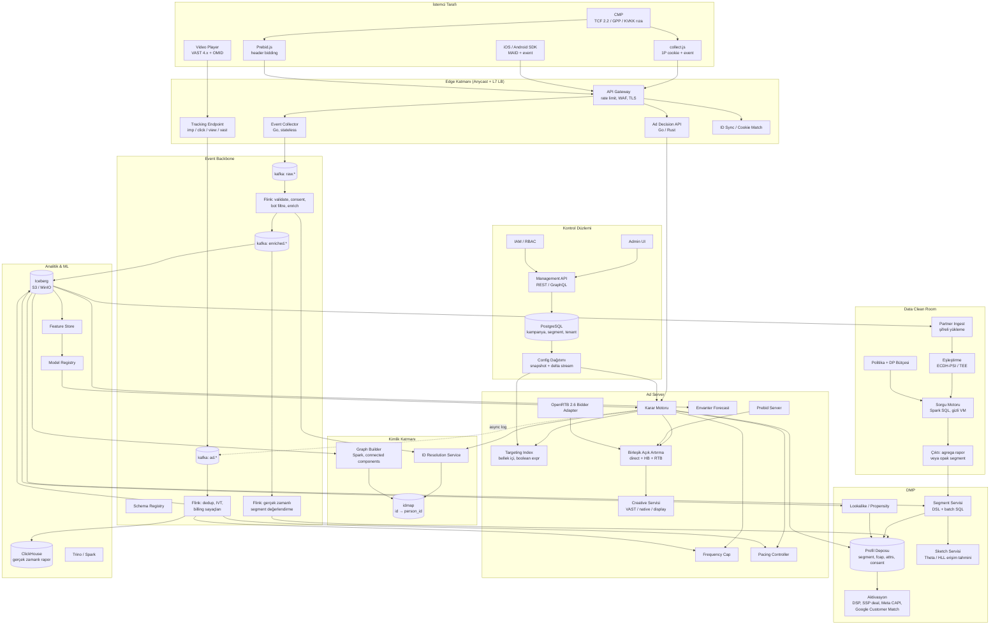

# 1. Genel Mimari

## 1.1 Katmanlar

| Katman | Sorumluluk | Ana bileşenler |
|--------|-----------|----------------|
| **Toplama (Collection)** | Web/app/CTV/S2S olaylarını ve reklam isteklerini almak | JS Tag, Mobil SDK, Event Collector, Ad Request API |
| **Event Backbone** | Olayların kalıcı, sıralı, şemalı taşınması | Kafka (KRaft), Schema Registry (Protobuf), Flink |
| **Kimlik (Identity)** | Kimlikleri birleştirmek, `person_id` üretmek | ID Resolution Service, Identity Graph |
| **DMP** | Profil, segment, aktivasyon | Profil Deposu, Segment Motoru, Lookalike, Aktivasyon |
| **Ad Server** | Reklam kararı, açık artırma, teslimat | Karar Motoru, Targeting Index, Pacing, Frequency Cap, RTB |
| **Data Clean Room** | Partnerle gizlilik korumalı ortak analiz | Eşleştirme (PSI/TEE), Politika Motoru, DP, Audit |
| **Analitik** | Raporlama, BI, model eğitimi | ClickHouse, Iceberg Lakehouse, Trino, Spark |
| **ML Platformu** | CTR/CVR, bid shading, lookalike, IVT modelleri | Feature Store, Model Registry, gömülü model sunumu |
| **Kontrol Düzlemi** | Kampanya yönetimi, kullanıcı/tenant yönetimi, faturalama | Admin UI, Management API, IAM, Billing |
| **Gizlilik & Güvenlik** | Rıza, silme talepleri, şifreleme, denetim | CMP Entegrasyonu, Consent Service, DSAR Pipeline, KMS, Audit Log |

## 1.2 Detaylı Bileşen Şeması

## 1.3 Ana Veri Akışları

### A) Davranışsal veri → Profil (DMP yolu)
1. `collect.js` / SDK olayı (page_view, product_view, purchase vb.) + rıza dizesi + kimlikler Collector'a gelir.
2. Collector şemayı doğrular, `received_time` ekler, **senkron yanıtı 204** olarak döner ve olayı `raw.web_events` topic'ine yazar (yerel diske tampon ile — Kafka erişilemezse kayıp olmaz).
3. Flink: şema doğrulama → rıza filtresi (profilleme amacı yoksa olay yalnızca agregat analitiğe gider) → bot filtresi → zenginleştirme (GeoIP, UA, içerik kategorisi) → kimlik çözümleme (`person_id`) → `enriched.*` topic.
4. Gerçek zamanlı segment kuralları Flink keyed state'te değerlendirilir; üyelik değişiklikleri profil deposuna yazılır (saniyeler mertebesinde).
5. Tüm olaylar Iceberg'e düşer; günlük batch işler (identity graph, karmaşık segmentler, lookalike) buradan çalışır.

### B) Reklam isteği → Karar → Teslimat (Ad Server yolu)
1. Sayfa / app / player reklam ister (doğrudan ad tag, Prebid.js sonrası ad server çağrısı veya OpenRTB isteği).
2. Karar motoru: rıza kontrolü → kimlik ve profil okuma → aday line item'ların indeks ile çekilmesi → filtreler (fcap, pacing, brand safety, deal) → skorlama (eCPM) → header bidding / RTB teklifleriyle birleşik açık artırma → kreatif yanıtı.
3. Karar olayı **asenkron** olarak `ad.decisions` topic'ine yazılır.
4. Gösterim / görünürlük / tıklama beacon'ları imzalı URL'ler ile Tracking endpoint'e gelir → `ad.events` → Flink (dedup, IVT, faturalama) → ClickHouse + pacing + fcap sayaçları.

### C) Partner verisi → Clean Room → Aktivasyon / Ölçümleme
1. Partner (reklamveren, perakendeci) kendi anahtarıyla şifrelenmiş / hash'lenmiş verisini yükler.
2. PSI veya TEE içinde eşleştirme yapılır; hiçbir taraf diğerinin eşleşmeyen kayıtlarını görmez.
3. Yalnızca onaylı şablon sorgular çalışır; çıktıya eşik ve diferansiyel gizlilik gürültüsü uygulanır.
4. Çıktı ya agrega rapordur (erişim, örtüşme, satış atıflaması) ya da ad server içinde hedeflenebilen ama dışa aktarılamayan **opak segment**tir.

## 1.4 Çok Kiracılılık (Multi-Tenancy)

- Her kayıt ve her olay `tenant_id` taşır; Kafka partition anahtarı `tenant_id + person_id` hash'idir.
- Profil deposunda anahtar `tenant_id:person_id` şeklindedir; kiracılar arası kimlik birleştirme **varsayılan olarak kapalıdır** (yalnızca clean room üzerinden, sözleşme ile).
- Kiracı başına ayrı şifreleme anahtarı (KMS envelope encryption) — kiracı ayrıldığında anahtar imhası ile kriptografik silme (crypto-shredding).
- Büyük kiracılar için ayrık (dedicated) Kafka topic'leri ve ClickHouse shard'ları seçeneği.
