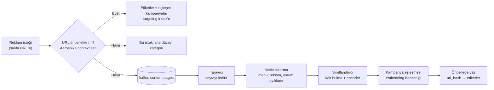

# 2. Ad Server

Ad server; doğrudan satış (direct / guaranteed), header bidding, programatik (OpenRTB, PMP / PG deal) ve house reklamları **tek bir birleşik açık artırmada** yöneten, gerçek zamanlı karar motorudur.

## 2.1 Envanter ve Kampanya Hiyerarşisi

```
Tenant (Yayıncı / Ağ)
 ├── Envanter: Site / App → Ad Unit (yerleşim) → Boyut / Format
 └── Satış: Reklamveren → Order (Kampanya) → Line Item → Creative
                                         └── Deal (PMP / PG)
```

### Line item türleri ve öncelik katmanları

| Öncelik | Tür | Karar mantığı |
|---------|-----|---------------|
| 1 | **Sponsorship** | Belirtilen trafiğin %X'i garanti; açık artırmaya girmez |
| 4 | **Standard (Garantili)** | Hedef gösterim sayısına ulaşmak için pacing ile teslim (allocation plan) |
| 6 | **Programmatic Guaranteed** | Sabit fiyat, garanti hacim, DSP üzerinden |
| 8 | **Preferred Deal / PMP** | Sabit fiyat ya da floor ile özel açık artırma |
| 12 | **Price Priority / Open Auction** | Header bidding + RTB + non-garantili direct, en yüksek eCPM kazanır |
| 16 | **House** | Doldurulamayan envanter |

> Garantili line item'lar için kısıt **teslimat hedefine ulaşmaktır**, gelir maksimizasyonu değil. Price priority katmanında ise kriter **eCPM**'dir. Modern yaklaşım: garantili line item'lara "gölge fiyat" (opportunity cost) verip hepsini aynı açık artırmada yarıştırmak (HWM / SHALE benzeri allocation plan algoritmaları).

## 2.2 Reklam İsteği Akışı (Sequence)

```mermaid
sequenceDiagram
    autonumber
    participant P as Sayfa / App / Player
    participant G as Edge Gateway
    participant D as Karar Motoru
    participant I as ID Resolution
    participant PR as Profil Deposu
    participant X as Targeting Index (bellek içi)
    participant HB as Prebid Server / RTB Bidders
    participant M as CTR/CVR Modeli (in-process)
    participant K as Kafka (async)
    participant T as Tracking Endpoint

    P->>G: Ad request (ad unit, sayfa URL, rıza dizesi, 1P id, MAID, PPID)
    G->>D: Doğrulanmış istek + GeoIP + UA
    D->>D: Rıza biti okunur (edge'de çözüldü; kişiselleştirme kapalıysa profil okuması atlanır)
    par Kimlik + profil (sıralı iki okuma, toplam timeout 5 ms)
        D->>I: id → person_id
        I-->>D: person_id
        Note over D,PR: Profil anahtarı tenant:person_id olduğu için<br/>bu okuma idmap yanıtını bekler
        D->>PR: profil (segment, fcap, attrs)
        PR-->>D: profil kaydı
    and Programatik talep (Exchange tmax ≈ 100 ms, bkz. 9)
        D->>HB: OpenRTB 2.6 BidRequest (user.data segmentleri, schain, deal id)
        HB-->>D: BidResponse listesi
    end
    D->>X: Hedefleme özellikleriyle aday line item sorgusu
    X-->>D: Aday listesi
    D->>D: Filtreler: fcap, pacing throttle, brand safety, kreatif uyumu, rekabet ayrımı
    D->>M: pCTR / pCVR skorlama
    M-->>D: Skorlar
    D->>D: eCPM normalizasyonu + floor + birleşik açık artırma
    D-->>P: Yanıt: kreatif markup / VAST + imzalı tracking URL'leri
    D--)K: AdDecision olayı (async, batch)
    P->>T: Impression / viewable / click / quartile beacon
    T--)K: AdEvent
```

## 2.3 Karar Motoru İç Yapısı

### 2.3.1 Targeting Index
- Tüm aktif line item'lar **bellek içinde** tutulur; kontrol düzleminden **snapshot + delta stream** ile güncellenir (PostgreSQL → CDC → config topic → her ad server pod'u).
- Hedefleme ifadeleri DNF'e (disjunctive normal form) derlenir ve **conjunction index** (Whang ve ark., *Indexing Boolean Expressions*, VLDB 2009) ile indekslenir. Böylece 100K+ line item arasında aday bulma O(log n)'e yakın sürede (< 1 ms) olur.
- Hedefleme boyutları: coğrafya (ülke/il/ilçe, posta kodu, geofence), cihaz/OS/tarayıcı, ad unit / site / app, içerik kategorisi (IAB Content Taxonomy), anahtar-değer (key-value), audience segmenti, gün/saat (dayparting), bağlantı tipi, operatör, dil, yeni/geri dönen kullanıcı.

Hedefleme DSL örneği:

```json
{
  "all": [
    { "dim": "geo.city",   "op": "in", "values": ["istanbul", "ankara", "izmir"] },
    { "dim": "device.type","op": "in", "values": ["mobile", "tablet"] },
    { "any": [
        { "dim": "audience.segment",  "op": "in", "values": [10234, 10235] },
        { "dim": "context.category",  "op": "in", "values": ["automotive"] }
    ]},
    { "not": { "dim": "audience.segment", "op": "in", "values": [99001] } },
    { "dim": "time.hour_local", "op": "between", "values": [8, 23] }
  ]
}
```

### 2.3.2 Frequency Capping
- Kurallar: `{ "scope": "line_item|campaign|advertiser", "max": 3, "window": "24h" }` (çoklu kural desteklenir).
- Sayaçlar profil kaydında `fcap` haritasında iki çözünürlükte tutulur: son 24 saat için **saatlik** kovalar (24 eleman) ve son 30 gün için **günlük** kovalar (30 eleman) → `≤ 24h` pencereler saatlik, `7d` / `30d` pencereler günlük kovalardan ucuzca hesaplanır. 30 günden uzun (ör. kampanya ömrü boyu) kurallar için ayrı bir toplam sayaç (`total`) tutulur.
- **İki aşamalı güncelleme:** (1) Ad server, yanıt döndüğü anda yerel/iyimser sayaç artırır (burst'te aşırı teslimatı önler); (2) gerçek impression olayı Flink üzerinden profil deposunda kalıcı sayacı artırır.
- Kimliği ya da rızası olmayan trafik için tarayıcıda depolama (cookie, localStorage) **kullanılmaz**; bu da rıza gerektirir ([7.2](07-gizlilik-ve-uyum.md#72-rıza-consent-sorumluluk-ve-akış)). Yalnızca kimliksiz kurallar uygulanır: aynı sayfa görüntülemesinde (`page_view_id`) aynı kampanyayı tekrar göstermeme ve rekabet ayrımı.

### 2.3.3 Pacing (Bütçe / Teslimat Hızı)
- Modlar: `even` (gün boyu eşit), `asap`, `front_loaded`.
- **Pacing Controller** (merkezi, her ~10 sn): her line item için hedef teslimat eğrisini (trafik tahmini profiline göre saat-saat) gerçekleşen teslimatla kıyaslar ve bir **throttle olasılığı** (0–1) üretir. PID kontrolcü kullanılır.
- Ad server pod'ları throttle oranını config stream'den alır; karar anında `rand() < throttle` ile line item'ı yarışa sokar → merkezi senkron sayaç okuması gerekmez.
- Bütçe tükenme koruması: Flink gerçek zamanlı harcama sayacı, %98'de "soft stop", %100'de "hard stop" sinyali yayınlar. Kabul edilebilir aşırı teslimat toleransı (ör. %1–2) sözleşmede tanımlanır.

### 2.3.4 Skorlama ve eCPM Normalizasyonu

| Fiyatlama | eCPM formülü |
|-----------|-------------|
| CPM | `bid` |
| vCPM | `bid × pViewable` |
| CPC | `bid × pCTR × 1000` |
| CPA | `bid × pCTR × pCVR × 1000` |
| CPCV (video) | `bid × pCompletion × 1000` |
| Garantili | `gölge_fiyat(line_item, teslimat_açığı)` |

- Modeller (LightGBM / küçük DNN) ONNX formatında **ad server prosesine gömülü** çalışır (ağ çağrısı yok, < 2 ms).
- Kalibrasyon (isotonic regression) şarttır; aksi halde CPC/CPA kampanyalar CPM ile adil yarışamaz.
- **pViewable modeli:** vCPM eCPM'i ve dinamik floor bu tahmini kullanır. Girdiler: ad unit konumu (katlama üstü / altı), sayfa uzunluğu, cihaz, sayfanın ortalama scroll derinliği (agrega), yerleşimin geçmiş görünürlük oranı. Model GBDT; etiket OM SDK / görünürlük beacon'ından gelir.

### 2.3.5 Birleşik Açık Artırma
- Katılımcılar: direct line item'lar (eCPM), header bidding teklifleri (Prebid), Ad Exchange'in kazanan teklifi (kendi DSP'miz + harici DSP'ler, bkz. [9](09-exchange-ve-dsp.md)), deal'ler.
- Mekanizma: **first-price** (sektör standardı); dinamik **floor** (ad unit × ülke × cihaz × saat bazlı, ML ile optimize edilen).
- **Net karşılaştırma:** Adaylar yayıncıya kalan **net** tutar üzerinden yarışır. Exchange kazananı `fiyat × (1 − take rate)`, Prebid teklifleri ilgili SSP'nin ücreti düşülmüş olarak, doğrudan line item'lar eCPM'in (garantilide gölge fiyatın) tamamıyla girer. Brüt fiyatla karşılaştırmak RTB'yi olduğundan değerli gösterir ve yayıncının gelirini düşürür.
- Yayıncının panelde girdiği taban fiyatlar **net**tir; Exchange'e giden `bidfloor` = net taban ÷ (1 − take rate).
- **Aynı alıcı tekilleştirme:** Aynı alıcı (seat + `adomain`) hem Prebid üzerinden başka bir SSP'den hem Exchange'den teklif verirse yalnızca net değeri yüksek olan teklif kalır; alıcı kendi fiyatını yükseltmez.
- Rekabet ayrımı (competitive exclusion): aynı sayfada rakip markaların gösterilmemesi; `adomain` ve kategori bazlı engelleme.
- Kazanan seçildikten sonra: win notice (`nurl`), billing notice (`burl`) ve loss notice (`lurl`) gönderilir.

### 2.3.6 Programatik Entegrasyon
- **Prebid Server** (Go sürümü) ile sunucu taraflı header bidding; Prebid.js ile istemci taraflı.
- **OpenRTB 2.6** bid request: `imp`, `site/app`, `device`, `user.eids` (UID2, ID5 vb.), `user.data` (Seller-Defined Audiences, IAB Audience Taxonomy), `source.schain`, `regs` (GDPR/GPP), `pmp.deals`.
- Arz zinciri şeffaflığı: `ads.txt`, `app-ads.txt`, `sellers.json`, `SupplyChain` nesnesi.
- Bidder başına timeout, QPS limiti ve **traffic shaping** (düşük teklif oranlı bidder'lara istek kısma) — maliyet ve gecikme için kritik.

### 2.3.7 Kreatif Seçimi (Optimizasyon)
Bir line item'ın birden çok kreatifi varsa hangisinin gösterileceğine sabit ağırlık değil, öğrenen bir kural karar verir.

- **Yöntem:** Thompson sampling. Her (line item, kreatif) için başarı / deneme sayılarından `Beta(başarı + 1, deneme − başarı + 1)` dağılımı tutulur; istek anında her kreatif için bir örnek çekilir, en yükseği gösterilir. İyi performans gösteren kreatife trafik kendiliğinden kayar, yeni kreatif keşif payı alır.
- **Başarı tanımı kampanya hedefine göre:** tıklama (CPC), görüntülenebilir gösterim (vCPM), tamamlanan izleme (CPCV), dönüşüm (CPA).
- **Maliyet:** Sayaçlar Flink'te toplanır ve config akışıyla dakikada bir ad server'a gelir; istek anında yalnızca bellekte birkaç sayı çekilir, yazma yoktur.
- **Kreatif yorgunluğu:** Aynı kişiye aynı kreatif üst üste N kez gösterildiyse sıradaki seçilir (frekans kovalarında kreatif bazlı sayaç).
- **Reklamveren tercihi:** A/B testi isteyen reklamveren "eşit dağıt" seçebilir; o zaman bandit kapalıdır.

## 2.4 Kreatif ve Formatlar

| Format | Standart |
|--------|----------|
| Display | IAB boyutları, HTML5, SafeFrame |
| Video | **VAST 4.2/4.3**, VMAP, ad pod'ları, SSAI (sunucu taraflı ekleme) |
| İnteraktif video | SIMID (VPAID yerine) |
| Görünürlük | **OM SDK (OMID)** |
| Native | OpenRTB Native 1.2 |
| CTV | VAST + SSAI, IFA (`ifa_type`) |
| Rich media | MRAID 3.0 (in-app) |
| Üçüncü taraf etiket | Başka bir ad server'ın (ör. reklamverenin) JS / iframe etiketi; SafeFrame içinde, izinli alan adı listesiyle |
| Özel formatlar | Masthead, pageskin, sticky / anchor, interstitial — yayıncı şablonları ile; IAB LEAN ve Better Ads Standartlarına uygun |

Kreatif akışı:

1. **Yükleme:** Reklamveren, ajans ya da ad ops kreatifi panelden veya API'den yükler.
2. **Otomatik tarama:** Zararlı kod, kötü amaçlı yönlendirme, boyut / dosya ağırlığı, SSL, üçüncü taraf etiketlerde izinsiz alan adı çağrısı.
3. **İçerik onayı:** Kategori, rakip marka ve uygunsuz içerik kontrolü; manuel onay. Onaylanan kreatif `review_status = approved` olur.
4. **CDN'e yayın:** Varlıklar CDN'e alınır; ağır kreatif sınırları (IAB LEAN) uygulanır.
5. **Güvenli gösterim:** Kreatif yayıncı sayfasından yalıtılmış çerçevede (SafeFrame / cross-origin iframe) render edilir. Üçüncü taraf etiketler canlıda da örneklenerek yeniden taranır.

## 2.5 Tracking ve Ölçüm

- **Imzalı tracking URL:** `/imp?d=<base64(payload)>&s=<HMAC-SHA256>` — payload: `request_id`, `impression_id`, `line_item_id`, `creative_id`, `price_micros`, `ts`. Sahte beacon ve fiyat manipülasyonu önlenir.
- **Dedup:** `impression_id` üzerinden Flink'te 24 saatlik state ile tekilleştirme.
- **Gösterim sayımı:** MRC / IAB kılavuzuna uygun "begin-to-render" sayımı; görünürlük: display %50 piksel / 1 sn, video %50 piksel / 2 sn.
- Click: 302 redirect servisi (`/clk`), açık yönlendirme (open redirect) korumalı — yalnızca imzalı hedefe.
- Video: start, firstQuartile, midpoint, thirdQuartile, complete, skip, mute vb.
- Dönüşüm: pixel + S2S Conversion API; atıflama penceresi (post-click / post-view) ayarlanabilir.

## 2.6 IVT (Geçersiz Trafik) ve Marka Güvenliği

| Katman | Yöntem |
|--------|-------|
| **GIVT** | IAB/ABC bot & spider listesi, veri merkezi IP listeleri, bilinen tarayıcı dışı UA |
| **SIVT** | Davranışsal ML (tıklama zamanlaması, oturum anomalileri, cihaz sinyali tutarsızlığı (ör. UA iPhone diyor, ekran ve yazı tipleri masaüstü gösteriyor), IP konumu ile tarayıcı saat dilimi uyuşmazlığı, aynı cihazdan aşırı istek, olağan dışı saat yoğunlukları), click-injection, SDK spoofing tespiti |
| **Pre-bid** | İstek anında, **ad server'da bir kez**: ucuz kurallar + itibar skoru. Sonuç `ivt_flag` olarak Exchange'e taşınır; Exchange yeniden kontrol etmez. `ads.txt` / `app-ads.txt` ve `sellers.json` yetkisi günlük tarama işiyle hesaplanır, istek anında önbellekten okunur |
| **Post-impression** | Flink + batch analiz; faturadan düşme ve iade ([10.5](10-faturalama-ve-para-akisi.md#105-sahte-trafik-iadesi)) |
| **Cihaz sinyallerinin sınırı** | Yalnızca istek anında, bot / sahte trafik kararı için değerlendirilir; kalıcı bir kimliğe (fingerprint) dönüştürülmez, siteler arasında bağlanmaz, profile yazılmaz. Tam IP yalnızca IVT için 7 gün tutulur |
| **Yayıncı kalite puanı** | Yayıncı / site bazında IVT oranı, görünürlük, kreatif şikayetleri ve ads.txt uyumundan günlük hesaplanan puan; düşük puanlı envanter DSP'lere kısılarak ya da hiç gönderilmez, ağa katılımda eşik olarak kullanılır |

Şüpheli trafik teklife girmez, rapora yansımaz ve faturadan düşülür.
| **Marka güvenliği** | Sayfa içerik sınıflandırma, anahtar kelime / kategori blok listeleri, 3. parti doğrulama (IAS, DV) entegrasyonu |

## 2.7 Envanter Tahmini (Forecasting)

- Geçmiş ad request'lerinin **%1'lik örneklemi** (tüm hedefleme özellikleriyle) saklanır.
- Yeni line item rezervasyonunda: örneklem üzerinde mevcut garantili line item'larla birlikte teslimat simülasyonu → **kullanılabilir (available)** ve **çakışan (contended)** gösterim tahmini.
- Mevsimsellik için zaman serisi modeli (Prophet / gradient boosting) ile ölçekleme.
- **Erişim ve frekans planlama:** Reklamveren "bu kitlede N tekil kişiye ortalama F kez" hedefi girer. Örneklem ve Theta sketch'lerle tekil erişim eğrisi çıkarılır; hedef için gereken gösterim, bütçe ve süre hesaplanır. Garantili rezervasyonda ve büyük reklamveren tekliflerinde kullanılır.

## 2.8 Raporlama Boyutları ve Metrikler

- **Boyutlar:** tarih/saat, tenant, reklamveren, kampanya, line item, kreatif, ad unit, site/app, ülke/il, cihaz, OS, tarayıcı, deal, bidder, segment.
- **Metrikler:** ad request, matched request, impression, viewable impression, click, CTR, video quartile'ları, VCR, dönüşüm, gelir (TRY/USD/EUR), eCPM, fill rate, bid rate, win rate, timeout rate, IVT oranı, tekil erişim (sketch tabanlı), ortalama frekans.

## 2.9 Yayıncı Paneli ve Ağa Katılım

Platform önce kendi sitelerimizde çalışır, sonra Türkiye'deki dış yayıncılara açılır (Türkiye ağı). Her yayıncı ayrı bir tenant'tır ([1.4](01-genel-mimari.md#14-çok-kiracılılık-multi-tenancy)).

### Ağa katılım (onboarding)
1. **Başvuru ve inceleme:** Şirket bilgileri, vergi numarası, banka hesabı; içerik ve trafik kalitesi incelemesi (yayıncı kalite puanı eşiği, [2.6](#26-ivt-geçersiz-trafik-ve-marka-güvenliği)).
2. **Sözleşme:** Gelir payı / take rate ([10.4](10-faturalama-ve-para-akisi.md#104-komisyon-ve-gelir-paylaşımı)), ödeme vadesi, KVKK veri işleyen hükümleri, rıza yönetimi (CMP) yükümlülüğü.
3. **Teknik kurulum:** Yayıncının `ads.txt` dosyasına platform satırı eklenir; yayıncı platformun `sellers.json` dosyasına yazılır; reklam etiketi veya Prebid.js yapılandırması, CMP entegrasyonu.
4. **Doğrulama:** Test trafiği, ads.txt tarayıcısının satırı görmesi, ilk günün IVT ve görünürlük oranları. Ardından envanter Exchange'e açılır.

### Panel işlevleri
- **Envanter:** Site / uygulama ve reklam alanı (ad unit) tanımı, boyut ve formatlar, özel formatlar.
- **Taban fiyat kuralları:** Ülke, cihaz, format ve ad unit bazında; deal bazında ayrı floor.
- **Blok listeleri:** Rakip marka (`adomain`), hassas kategori (IAB), kreatif özellikleri; reklamveren ve DSP bazında engelleme.
- **Doğrudan satış:** Yayıncının kendi kampanyaları ve PG / PMP deal yönetimi.
- **Rapor ve hakediş:** Gelir, eCPM, doluluk, IVT düzeltmeleri, aylık hakediş raporu ([10.7](10-faturalama-ve-para-akisi.md#107-faturalama-ve-vergi)).

### Getiri optimizasyonu (yield)
- **Taban fiyat önerisi:** Geçmiş teklif dağılımından ad unit × ülke × cihaz × saat bazında önerilen floor (ML ile dinamik floor'un yayıncıya görünen yüzü).
- **Doğrudan / programatik karşılaştırma:** Aynı envanterde garantili kampanyaların eCPM'i ile Exchange'in kazanan fiyatları; gölge fiyat ayarı önerileri.
- **Doluluk takibi:** Fill rate, boş kalan gösterimler ve nedenleri (no-fill reason: floor, timeout, blok, hedefleme).
- **Yetkili satıcı sağlığı:** ads.txt / sellers.json tutarlılık uyarıları.

## 2.10 Kontekstüel Hedefleme

Rızası olmayan ya da kimliği bilinmeyen trafikte hedeflemenin tek sinyali **sayfanın kendisidir**; fingerprint ve 3. parti cookie kullanılmadığı için bu trafiğin geliri kontekstüel kaliteye bağlıdır. Kontekstüel hedefleme kişiyi değil sayfayı hedefler: profil okumaz, kimlik kullanmaz, rıza durumundan bağımsız olarak tüm trafikte çalışır.



**Kural: istek anında model çalışmaz.** Sayfa yalnızca ilk görüldüğünde (ve trafik almaya devam ederse 24 saatte bir) sınıflandırılır; istek anında tek bir önbellek okuması yapılır. Önbellekte olmayan URL'nin ilk istekleri site düzeyi kategoriyle karar verir, beklemez.

**Çıktılar (URL başına)**

| Çıktı | Örnek | Kullanım |
|-------|-------|----------|
| IAB Content Taxonomy kategorisi | `Automotive > Electric Vehicles` | Kategori hedeflemesi, raporlama |
| Anahtar kelimeler ve varlıklar (kök hâlinde) | `otomobil`, `Togg`, `İstanbul` | Anahtar kelime hedeflemesi, rekabet ayrımı |
| Duygu | olumlu / nötr / olumsuz | Marka güvenliği |
| Marka güvenliği sınıfı | felaket, şiddet, yetişkin, siyasi… | Reklamveren blok listeleri (filtre aşaması) |
| Sayfa embedding'i | 384–768 boyutlu vektör | Anlamsal kampanya eşleşmesi |
| Dil | `tr`, `en` | Dil hedeflemesi |

**Anlamsal eşleşme:** Reklamveren kampanyaya bir kontekst tanımı girer (serbest metin ya da örnek URL'ler; ör. "elektrikli araç, şarj, menzil"). Tanımın embedding'i ile sayfa embedding'inin benzerliği eşiği geçerse kampanya o sayfada aday olur; kategori etiketi olmasa da şarj istasyonu haberi eşleşir. Hesap sınıflandırma anında yapılıp `url → [kampanya, skor]` olarak saklanır; kampanya tanımı değişince arka plan işi etkilenen URL'leri yeniden puanlar.

**Türkçe'ye özgü:** Türkçe eklemeli olduğu için anahtar kelime eşleştirmesi kök bulmadan çalışmaz ("otomobil", "otomobilin", "otomobillerde" aynı kavramdır). Metin önce kök bulmadan geçer (ör. Zemberek), sınıflandırma Türkçe ya da çok dilli bir encoder ile yapılır (ör. BERTurk, multilingual-e5) ve IAB kategorilerine ince ayar (fine-tune) edilir.

**Ölçek:** Bir haber ağında günde onbinlerce yeni URL vardır; sınıflandırma toplu çalışan birkaç CPU sunucusuyla yapılabilir, GPU şart değildir.

**Hazır sağlayıcı seçeneği:** Başlangıçta bir kontekstüel sınıflandırma API'si kullanılabilir; ancak Türkçe kalitesi ve URL başına maliyet ölçülmeden karar verilmemelidir.

