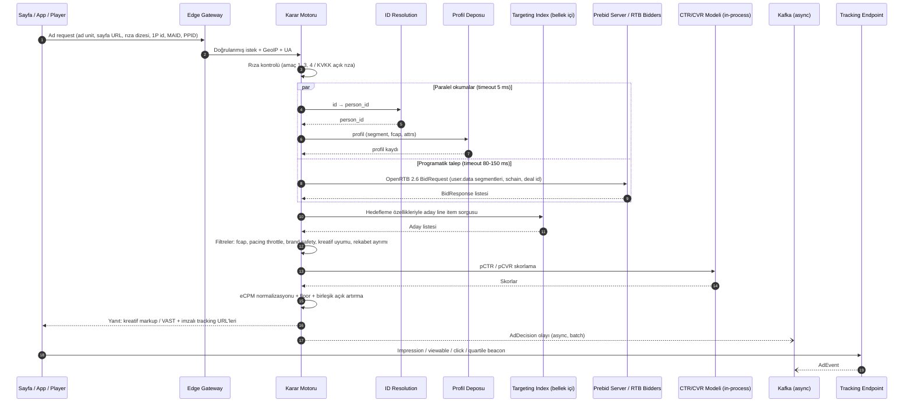

# 2. Ad Server

Ad server; doğrudan satış (direct / guaranteed), header bidding, programatik (OpenRTB, PMP / PG deal) ve house reklamları **tek bir birleşik açık artırmada** yöneten, gerçek zamanlı karar motorudur.

## 2.1 Envanter ve Kampanya Hiyerarşisi

```
Tenant (Yayıncı / Ağ)
 ├── Envanter: Site / App → Ad Unit (yerleşim) → Boyut / Format
 └── Satış: Reklamveren → Order (Kampanya) → Line Item → Creative
                                         └── Deal (PMP / PG)
```

### Line item türleri ve öncelik katmanları

| Öncelik | Tür | Karar mantığı |
|---------|-----|---------------|
| 1 | **Sponsorship** | Belirtilen trafiğin %X'i garanti; açık artırmaya girmez |
| 4 | **Standard (Garantili)** | Hedef gösterim sayısına ulaşmak için pacing ile teslim (allocation plan) |
| 6 | **Programmatic Guaranteed** | Sabit fiyat, garanti hacim, DSP üzerinden |
| 8 | **Preferred Deal / PMP** | Sabit fiyat ya da floor ile özel açık artırma |
| 12 | **Price Priority / Open Auction** | Header bidding + RTB + non-garantili direct, en yüksek eCPM kazanır |
| 16 | **House** | Doldurulamayan envanter |

> Garantili line item'lar için kısıt **teslimat hedefine ulaşmaktır**, gelir maksimizasyonu değil. Price priority katmanında ise kriter **eCPM**'dir. Modern yaklaşım: garantili line item'lara "gölge fiyat" (opportunity cost) verip hepsini aynı açık artırmada yarıştırmak (HWM / SHALE benzeri allocation plan algoritmaları).

## 2.2 Reklam İsteği Akışı (Sequence)



## 2.3 Karar Motoru İç Yapısı

### 2.3.1 Targeting Index
- Tüm aktif line item'lar **bellek içinde** tutulur; kontrol düzleminden **snapshot + delta stream** ile güncellenir (PostgreSQL → CDC → config topic → her ad server pod'u).
- Hedefleme ifadeleri DNF'e (disjunctive normal form) derlenir ve **conjunction index** (Whang ve ark., *Indexing Boolean Expressions*, VLDB 2009) ile indekslenir. Böylece 100K+ line item arasında aday bulma O(log n)'e yakın sürede (< 1 ms) olur.
- Hedefleme boyutları: coğrafya (ülke/il/ilçe, posta kodu, geofence), cihaz/OS/tarayıcı, ad unit / site / app, içerik kategorisi (IAB Content Taxonomy), anahtar-değer (key-value), audience segmenti, gün/saat (dayparting), bağlantı tipi, operatör, dil, yeni/geri dönen kullanıcı.

Hedefleme DSL örneği:

```json
{
  "all": [
    { "dim": "geo.city",   "op": "in", "values": ["istanbul", "ankara", "izmir"] },
    { "dim": "device.type","op": "in", "values": ["mobile", "tablet"] },
    { "any": [
        { "dim": "audience.segment",  "op": "in", "values": [10234, 10235] },
        { "dim": "context.category",  "op": "in", "values": ["automotive"] }
    ]},
    { "not": { "dim": "audience.segment", "op": "in", "values": [99001] } },
    { "dim": "time.hour_local", "op": "between", "values": [8, 23] }
  ]
}
```

### 2.3.2 Frequency Capping
- Kurallar: `{ "scope": "line_item|campaign|advertiser", "max": 3, "window": "24h" }` (çoklu kural desteklenir).
- Sayaçlar profil kaydında `fcap` haritasında, saatlik kova (bucket) dizisi olarak tutulur → kayan pencere hesabı ucuz olur.
- **İki aşamalı güncelleme:** (1) Ad server, yanıt döndüğü anda yerel/iyimser sayaç artırır (burst'te aşırı teslimatı önler); (2) gerçek impression olayı Flink üzerinden profil deposunda kalıcı sayacı artırır.
- Kimliği olmayan trafik için: istemci tarafı (localStorage) fcap veya oturum bazlı fcap.

### 2.3.3 Pacing (Bütçe / Teslimat Hızı)
- Modlar: `even` (gün boyu eşit), `asap`, `front_loaded`.
- **Pacing Controller** (merkezi, her ~10 sn): her line item için hedef teslimat eğrisini (trafik tahmini profiline göre saat-saat) gerçekleşen teslimatla kıyaslar ve bir **throttle olasılığı** (0–1) üretir. PID kontrolcü kullanılır.
- Ad server pod'ları throttle oranını config stream'den alır; karar anında `rand() < throttle` ile line item'ı yarışa sokar → merkezi senkron sayaç okuması gerekmez.
- Bütçe tükenme koruması: Flink gerçek zamanlı harcama sayacı, %98'de "soft stop", %100'de "hard stop" sinyali yayınlar. Kabul edilebilir aşırı teslimat toleransı (ör. %1–2) sözleşmede tanımlanır.

### 2.3.4 Skorlama ve eCPM Normalizasyonu

| Fiyatlama | eCPM formülü |
|-----------|-------------|
| CPM | `bid` |
| vCPM | `bid × pViewable` |
| CPC | `bid × pCTR × 1000` |
| CPA | `bid × pCTR × pCVR × 1000` |
| CPCV (video) | `bid × pCompletion × 1000` |
| Garantili | `gölge_fiyat(line_item, teslimat_açığı)` |

- Modeller (LightGBM / küçük DNN) ONNX formatında **ad server prosesine gömülü** çalışır (ağ çağrısı yok, < 2 ms).
- Kalibrasyon (isotonic regression) şarttır; aksi halde CPC/CPA kampanyalar CPM ile adil yarışamaz.

### 2.3.5 Birleşik Açık Artırma
- Katılımcılar: direct line item'lar (eCPM), header bidding teklifleri (Prebid), OpenRTB teklifleri, deal'ler.
- Mekanizma: **first-price** (sektör standardı); dinamik **floor** (ad unit × ülke × cihaz × saat bazlı, ML ile optimize edilen).
- Rekabet ayrımı (competitive exclusion): aynı sayfada rakip markaların gösterilmemesi; `adomain` ve kategori bazlı engelleme.
- Kazanan seçildikten sonra: win notice (`nurl`), billing notice (`burl`) ve loss notice (`lurl`) gönderilir.

### 2.3.6 Programatik Entegrasyon
- **Prebid Server** (Go sürümü) ile sunucu taraflı header bidding; Prebid.js ile istemci taraflı.
- **OpenRTB 2.6** bid request: `imp`, `site/app`, `device`, `user.eids` (UID2, ID5 vb.), `user.data` (Seller-Defined Audiences, IAB Audience Taxonomy), `source.schain`, `regs` (GDPR/GPP), `pmp.deals`.
- Arz zinciri şeffaflığı: `ads.txt`, `app-ads.txt`, `sellers.json`, `SupplyChain` nesnesi.
- Bidder başına timeout, QPS limiti ve **traffic shaping** (düşük teklif oranlı bidder'lara istek kısma) — maliyet ve gecikme için kritik.

## 2.4 Kreatif ve Formatlar

| Format | Standart |
|--------|----------|
| Display | IAB boyutları, HTML5, SafeFrame |
| Video | **VAST 4.2/4.3**, VMAP, ad pod'ları, SSAI (sunucu taraflı ekleme) |
| İnteraktif video | SIMID (VPAID yerine) |
| Görünürlük | **OM SDK (OMID)** |
| Native | OpenRTB Native 1.2 |
| CTV | VAST + SSAI, IFA (`ifa_type`) |
| Rich media | MRAID 3.0 (in-app) |

- Kreatif onay akışı: otomatik tarama (malware, ağır kreatif, SSL) + manuel onay.
- Kreatif CDN üzerinden; ağır kreatif sınırları (IAB LEAN).

## 2.5 Tracking ve Ölçüm

- **Imzalı tracking URL:** `/imp?d=<base64(payload)>&s=<HMAC-SHA256>` — payload: `request_id`, `impression_id`, `line_item_id`, `creative_id`, `price_micros`, `ts`. Sahte beacon ve fiyat manipülasyonu önlenir.
- **Dedup:** `impression_id` üzerinden Flink'te 24 saatlik state ile tekilleştirme.
- **Gösterim sayımı:** MRC / IAB kılavuzuna uygun "begin-to-render" sayımı; görünürlük: display %50 piksel / 1 sn, video %50 piksel / 2 sn.
- Click: 302 redirect servisi (`/clk`), açık yönlendirme (open redirect) korumalı — yalnızca imzalı hedefe.
- Video: start, firstQuartile, midpoint, thirdQuartile, complete, skip, mute vb.
- Dönüşüm: pixel + S2S Conversion API; atıflama penceresi (post-click / post-view) ayarlanabilir.

## 2.6 IVT (Geçersiz Trafik) ve Marka Güvenliği

| Katman | Yöntem |
|--------|-------|
| **GIVT** | IAB/ABC bot & spider listesi, veri merkezi IP listeleri, bilinen tarayıcı dışı UA |
| **SIVT** | Davranışsal ML (tıklama zamanlaması, oturum anomalileri, cihaz parmak izi tutarsızlığı), click-injection, SDK spoofing tespiti |
| **Pre-bid** | İstek anında filtre (ucuz kurallar + itibar skoru) |
| **Post-impression** | Flink + batch analiz, faturadan düşme |
| **Marka güvenliği** | Sayfa içerik sınıflandırma, anahtar kelime / kategori blok listeleri, 3. parti doğrulama (IAS, DV) entegrasyonu |

## 2.7 Envanter Tahmini (Forecasting)

- Geçmiş ad request'lerinin **%1'lik örneklemi** (tüm hedefleme özellikleriyle) saklanır.
- Yeni line item rezervasyonunda: örneklem üzerinde mevcut garantili line item'larla birlikte teslimat simülasyonu → **kullanılabilir (available)** ve **çakışan (contended)** gösterim tahmini.
- Mevsimsellik için zaman serisi modeli (Prophet / gradient boosting) ile ölçekleme.

## 2.8 Raporlama Boyutları ve Metrikler

- **Boyutlar:** tarih/saat, tenant, reklamveren, kampanya, line item, kreatif, ad unit, site/app, ülke/il, cihaz, OS, tarayıcı, deal, bidder, segment.
- **Metrikler:** ad request, matched request, impression, viewable impression, click, CTR, video quartile'ları, VCR, dönüşüm, gelir (TRY/USD), eCPM, fill rate, bid rate, win rate, timeout rate, IVT oranı, tekil erişim (sketch tabanlı), ortalama frekans.
