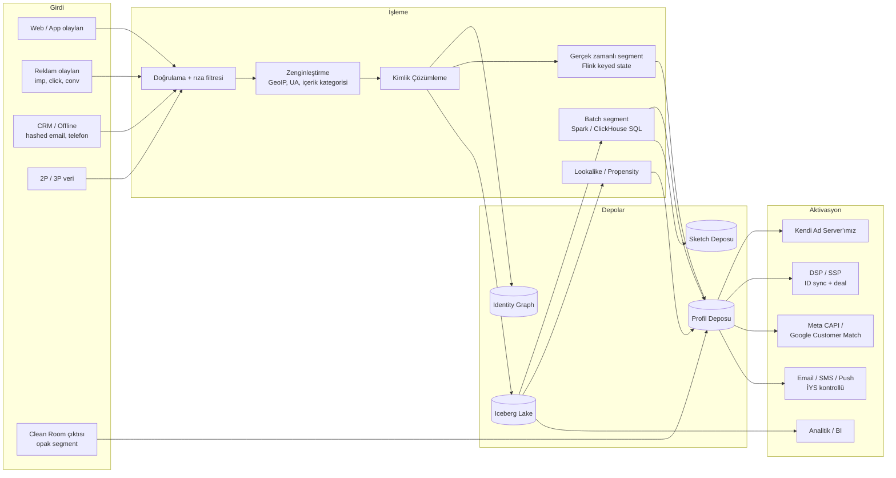
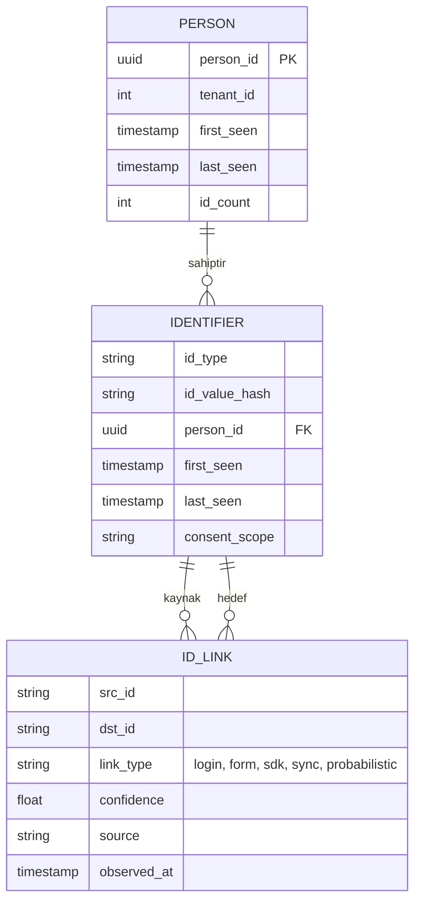

# 3. DMP (Data Management Platform)

DMP; 1. parti davranışsal verinin toplanması, kimliklerin birleştirilmesi, kitle (audience) segmentlerinin üretilmesi ve bu segmentlerin hem kendi ad server'ımızda hem de dış platformlarda aktive edilmesinden sorumludur. Kalıcı ve kimlikli profil tuttuğu için işlevsel olarak bir **CDP + DMP hibriti**dir.

## 3.1 DMP Veri Akışı



## 3.2 Veri Toplama

### Web Tag (`collect.js`)
- Asenkron, < 15 KB (gzip), CMP'den rıza durumunu okur (`__tcfapi`, `__gpp`, KVKK banner callback'i).
- **1. parti kimlik:** Yayıncının kendi alan adından, sunucu tarafından set edilen (`Set-Cookie`, HttpOnly, Secure, SameSite=Lax) cookie. Safari ITP kısıtları nedeniyle (CNAME cloaking ve farklı IP'den set edilen cookie'lerin ömrünün kısaltılması) collector'ın yayıncı altyapısı üzerinden (reverse proxy / aynı IP bloğu) sunulması önerilir.
- Olaylar `navigator.sendBeacon` ile batch gönderilir; sayfa kapanışında kayıp minimize edilir.
- Sunucu taraflı etiketleme (server-side tagging) seçeneği: yayıncının sunucusu olayları S2S API'ye iletir; ad blocker ve ITP etkisi azalır.

### Mobil SDK
- iOS: ATT izni varsa IDFA, yoksa IDFV + 1P kullanıcı kimliği; SKAdNetwork / AdAttributionKit desteği.
- Android: GAID (kullanıcı izin verdiyse), App Set ID.
- Offline kuyruk, batch gönderim, pil/veri dostu.

### Olay Taksonomisi

| Olay | Önemli alanlar |
|------|----------------|
| `page_view` | url, referrer, title, content_category, scroll_depth |
| `product_view` | sku, category, price, brand |
| `add_to_cart` / `remove_from_cart` | sku, qty, price |
| `purchase` | order_id, revenue, currency, items[] |
| `search` | query, results_count |
| `lead` / `sign_up` / `login` | method, hashed_email (login'de kimlik bağlama) |
| `video_*` | video_id, position, duration |
| `custom` | serbest key-value (şemada kayıtlı olmalı) |

## 3.3 Kimlik Çözümleme (Identity Resolution)

### Desteklenen kimlik türleri

| Tür | Kaynak | Kalıcılık | Not |
|-----|-------|-----------|-----|
| `fpc` | 1P cookie | Orta | Tarayıcı bazlı |
| `maid` | IDFA / GAID | Yüksek | İzne bağlı |
| `hem` | SHA-256(normalize email) | Çok yüksek | Login / form; deterministik |
| `hph` | SHA-256(E.164 telefon) | Çok yüksek | Deterministik |
| `ppid` | Yayıncı kullanıcı ID'si | Çok yüksek | Login tabanlı |
| `crm` | Reklamveren CRM ID | Yüksek | Yalnızca kendi tenant'ında |
| `uid2` / `id5` / `rampid` | Ortak kimlik çözümleri | Yüksek | Lisans / sözleşme gerektirir |
| `ip_ua` | IP + UA | Düşük | Yalnızca olasılıksal, kısa ömürlü |

### Identity Graph modeli



- **Deterministik bağlantılar:** aynı olayda birlikte görülen kimlikler (ör. login olayında `fpc` + `hem`).
- **Olasılıksal bağlantılar:** IP + zaman + davranış benzerliği; `confidence` skoruyla saklanır ve **varsayılan olarak hedeflemede kullanılmaz** (yalnızca açık rıza ve tenant politikası izin verirse).
- **Graph oluşturma:** günlük Spark işi — connected components (union-find) + kısıtlar:
  - Küme başına maksimum kimlik sayısı (ör. 50 cookie, 10 MAID); aşanlar "ortak cihaz" (kafe, kurumsal NAT) sayılıp bölünür → "dev küme" (giant component) problemi engellenir.
  - En eski bağlantılar zaman bazlı çürür (decay); 180 gün görülmeyen kimlik düşer.
- **Gerçek zamanlı yol:** `idmap` tablosu (id → person_id) her olayda okunur; yeni deterministik bağlantı geldiğinde iki person anında birleştirilir (merge olayı yayınlanır, profil kayıtları birleştirilir).

## 3.4 Profil Deposu

- Teknoloji: **Aerospike** (SSD + RAM indeksi, p99 < 1 ms) — alternatif ScyllaDB.
- Her okuma tek anahtarlı (single-key) olmalı: ad server isteği başına en fazla 2 okuma (`idmap` + `profile`).
- Kayıt yapısı için bkz. [Veri Modeli](05-veri-modeli.md#53-profil-kaydı-aerospike).
- Segment üyelikleri `seg_id → expire_epoch` olarak tutulur; okuma anında süresi dolanlar filtrelenir, arka planda temizlenir.
- Kayıt TTL'i: 180 gün inaktivite → otomatik silme (veri minimizasyonu).

## 3.5 Segmentasyon

### Segment türleri

| Tür | Örnek | Motor | Gecikme |
|-----|-------|-------|---------|
| **Gerçek zamanlı kural** | Son 7 günde ≥2 kez "otomobil" kategorisi ziyaret | Flink | saniyeler |
| **Batch SQL** | Son 90 günde 3+ satın alma ve sepet ort. > 1000 TL | Spark / ClickHouse | saatlik/günlük |
| **Lookalike** | Seed: son 30 gün alıcılar → benzer 1M kişi | Embedding + ANN | günlük |
| **Propensity** | 7 gün içinde satın alma olasılığı > 0.6 | GBDT modeli | günlük |
| **Kontekstüel** | Şu an "finans" içeriği okuyan | Ad server (istek anında) | anlık |
| **CRM / Onboard** | Sadakat programı "gold" üyeleri | Hashed eşleştirme | saatlik |
| **Clean Room** | Perakendecinin "bebek ürünü alıcısı" ile örtüşenler | DCR | günlük |
| **Kombinasyon** | (A ∪ B) ∩ ¬C | Set işlemleri | türetilmiş |

### Segment DSL örneği

```json
{
  "segment_id": 10234,
  "name": "Otomobil İlgilileri - Sıcak",
  "taxonomy": "iab_audience_1_1:automotive",
  "ttl_days": 30,
  "rule": {
    "all": [
      { "event": "page_view",
        "where": { "content_category": { "in": ["automotive"] } },
        "within": "7d",
        "count": { "gte": 2 } },
      { "event": "product_view",
        "where": { "price": { "gte": 500000 } },
        "within": "30d",
        "count": { "gte": 1 } }
    ],
    "none": [
      { "event": "purchase", "where": { "category": { "in": ["automotive"] } }, "within": "30d" }
    ]
  },
  "consent_required": ["profiling", "personalized_ads"]
}
```

- Gerçek zamanlı derleyici: DSL → Flink keyed state (kişi başına olay sayaç kovaları); her olayda yalnızca ilgili kurallar tetiklenir (olay türü → kural indeksi).
- Batch derleyici: aynı DSL → SQL (Trino/ClickHouse) → tutarlılık için gece "reconcile" işi.

### Erişim tahmini (Sketch)
- Her segment için **Theta Sketch** (Apache DataSketches) üretilir → UI'da "A ∩ B ∩ ¬C kaç kişi?" sorusu milisaniyede, ham veriye inmeden yanıtlanır.
- ClickHouse'ta `uniqCombined` / `uniqTheta` ile reklam erişimi ve frekans dağılımı.

## 3.6 Aktivasyon

| Kanal | Yöntem | Not |
|-------|--------|-----|
| **Kendi ad server'ımız** | İstek anında profil okuma | En düşük gecikme, en yüksek eşleşme |
| **DSP'ler** | ID sync (cookie matching) tablosu + segment push API'si | Partner ID eşleme tablosu `partner_id_map` |
| **SSP / Curated deal** | Segment → Deal ID; OpenRTB `user.data` (Seller-Defined Audiences) | Kimlik paylaşmadan veri değeri aktarımı |
| **Meta / Google / TikTok** | Hashed email/telefon ile Custom Audience / Customer Match, Conversions API | Açık rıza + veri işleme sözleşmesi |
| **CRM kanalları** | Email/SMS/push için segment export | **İYS** onayı olmayanlar gönderilmez |
| **Clean Room** | Segmenti DCR'ye girdi olarak ver | Satır verisi partnere gitmez |

## 3.7 Veri Kalitesi

- Şema kayıt zorunluluğu (Schema Registry, backward-compatible evrim).
- Flink'te geçersiz olaylar `dlq.*` (dead letter) topic'ine; günlük kalite raporu.
- Collector → Kafka → Iceberg arasında olay sayısı mutabakatı (reconciliation), kayıp oranı SLO'su < %0.01.
- Data contracts: her olay türü için sahip ekip, zorunlu alanlar, PII sınıflandırması.
