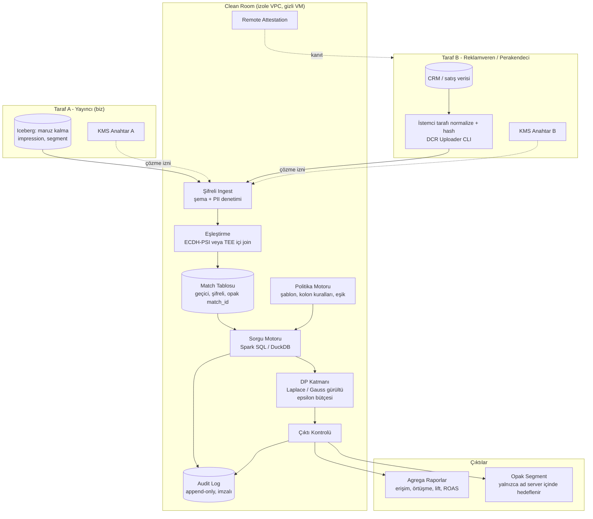
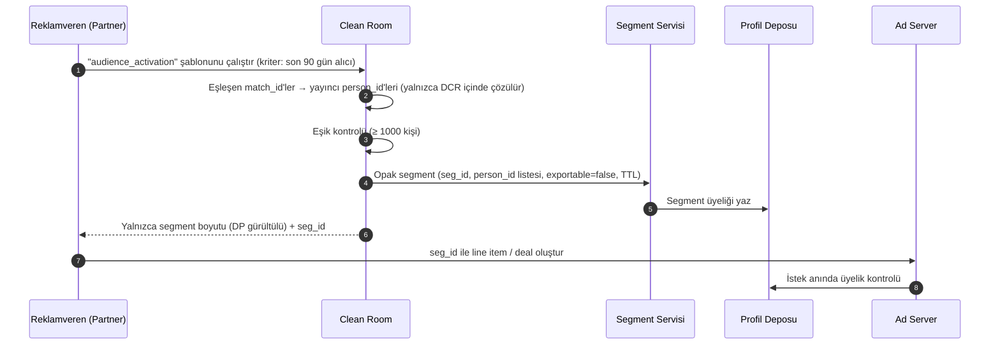

# 4. Data Clean Room (DCR)

Data Clean Room; iki veya daha fazla tarafın (yayıncı, reklamveren, perakendeci, telekom vb.) **ham, satır seviyesindeki verilerini birbirine göstermeden** ortak analiz, ölçümleme ve aktivasyon yapmasını sağlayan, teknik ve sözleşmesel kontrollerle korunan ortamdır.

## 4.1 Temel İlkeler

1. **Satır seviyesinde çıktı yok:** Hiçbir taraf diğerinin kayıtlarını göremez ve dışa aktaramaz.
2. **Her taraf kendi anahtarına sahip:** Veri, sahibinin KMS anahtarıyla şifreli saklanır; collaboration bitince anahtar erişimi kaldırılır.
3. **Yalnızca onaylı analiz:** Serbest SQL yok; her iki tarafın onayladığı **sorgu şablonları** çalışır.
4. **Agregasyon eşiği + gürültü:** Minimum grup büyüklüğü (k ≥ 50) ve diferansiyel gizlilik (DP) gürültüsü.
5. **Doğrulanabilir hesaplama:** Hesaplama gizli VM (TEE: AMD SEV-SNP / Intel TDX) içinde; remote attestation ile partner hangi kodun çalıştığını doğrular.
6. **Tam denetim izi:** Her sorgu, parametre, çıktı ve DP bütçe tüketimi değiştirilemez (append-only, imzalı) logda.
7. **Süreli ve amaca bağlı:** Her collaboration'ın amacı, süresi ve izinli analizleri sözleşmede ve konfigürasyonda tanımlıdır.

## 4.2 Mimari



## 4.3 Eşleştirme (Matching)

### Normalizasyon (her iki taraf aynı kuralları uygular)
- **Email:** trim → küçük harf → (opsiyonel Gmail nokta/artı temizliği) → SHA-256.
- **Telefon:** E.164 formatı (`+905321234567`) → SHA-256.
- Normalizasyon kütüphanesi Uploader CLI içinde dağıtılır; tutarsız normalizasyon eşleşme oranını ciddi düşürür.

### Eşleştirme yöntemleri

| Yöntem | Nasıl | Güven modeli | Ne zaman |
|--------|------|--------------|----------|
| **Hash join (TEE içinde)** | İki taraf hash'li ID'leri gizli VM'e şifreli yükler, join içeride yapılır | Donanım (TEE) + attestation'a güven | Varsayılan, en esnek |
| **ECDH-PSI** | Her taraf ID'leri kendi gizli anahtarıyla eliptik eğri üzerinde "çift şifreler"; yalnızca kesişim ortaya çıkar | Kriptografik; operatöre güven gerekmez | Hassas sektörler (finans, sağlık, telekom) |
| **Private Join & Compute** | PSI + homomorfik toplama ile kesişim üzerinde toplam (ör. satış tutarı) | Kriptografik | Yalnızca kesişim toplamı gereken ölçümleme |

- Eşleşme sonucunda gerçek ID'ler yerine collaboration'a özgü **opak `match_id`** (HMAC(collab_key, id)) üretilir; collaboration bitince anahtar imha edilir → match tablosu anlamsızlaşır.

## 4.4 Politika Motoru

Collaboration konfigürasyonu örneği:

```json
{
  "collaboration_id": "collab_2026_retailx_q4",
  "parties": ["tenant:publisher_42", "partner:retailx"],
  "purpose": "kampanya_olcumleme_ve_aktivasyon",
  "valid_from": "2026-10-01",
  "valid_to": "2027-01-31",
  "matching": { "method": "tee_hash_join", "keys": ["hem", "hph"] },
  "column_rules": {
    "publisher_42.exposures":  { "join": ["match_id"], "dimensions": ["campaign_id", "creative_id", "date"], "aggregate_only": [] },
    "retailx.sales":           { "join": ["match_id"], "dimensions": ["category", "date"], "aggregate_only": ["revenue", "units"] }
  },
  "allowed_templates": ["overlap_report", "reach_frequency", "sales_lift", "audience_activation"],
  "privacy": {
    "min_aggregation_threshold": 50,
    "differential_privacy": { "enabled": true, "epsilon_total": 10.0, "epsilon_per_query_max": 1.0, "delta": 1e-9 },
    "max_queries_per_day": 50
  },
  "outputs": {
    "reports": { "recipients": ["retailx", "publisher_42"] },
    "activation": { "allowed": true, "destination": "publisher_42.ad_server", "exportable": false, "min_segment_size": 1000 }
  }
}
```

### Kontroller
- **Kolon rolleri:** `join` (yalnızca eşleştirmede), `dimension` (gruplamada), `aggregate_only` (yalnızca SUM/AVG/COUNT içinde). `SELECT *` ve satır döndüren sorgular derleme aşamasında reddedilir.
- **Eşik:** Sonuç tablosundaki her hücre için `COUNT(DISTINCT match_id) ≥ k`; altındakiler bastırılır.
- **Fark saldırısı (differencing attack) koruması:** Birbirine çok benzeyen filtrelerle art arda sorgu tespiti; DP gürültüsü ve bütçe bu riski matematiksel olarak sınırlar.
- **DP bütçesi:** Her sorgu epsilon tüketir; collaboration bütçesi bittiğinde yeni sorgu çalışmaz.

## 4.5 Sorgu Şablonu Örneği — Satış Lift Analizi

```sql
-- Şablon: sales_lift  (parametreler: :campaign_id, :start, :end, :category)
WITH exposed AS (
    SELECT DISTINCT match_id
    FROM publisher_42.exposures
    WHERE campaign_id = :campaign_id
      AND date BETWEEN :start AND :end
),
holdout AS (                      -- kampanya kurulumunda ayrılmış kontrol grubu
    SELECT DISTINCT match_id
    FROM publisher_42.holdout_assignments
    WHERE campaign_id = :campaign_id
),
sales AS (
    SELECT match_id, SUM(revenue) AS revenue
    FROM retailx.sales
    WHERE date BETWEEN :start AND :end + INTERVAL '14' DAY
      AND category = :category
    GROUP BY match_id
)
SELECT
    grp,
    COUNT(*)                                       AS users,          -- DP gürültüsü eklenir
    SUM(CASE WHEN s.revenue > 0 THEN 1 ELSE 0 END) AS buyers,         -- DP gürültüsü eklenir
    SUM(COALESCE(s.revenue, 0))                    AS revenue         -- clamp + DP gürültüsü
FROM (
    SELECT match_id, 'exposed' AS grp FROM exposed
    UNION ALL
    SELECT match_id, 'holdout' AS grp FROM holdout
) g
LEFT JOIN sales s USING (match_id)
GROUP BY grp
HAVING COUNT(*) >= 50;
```

> Politika motoru bu şablonu çalıştırmadan önce: parametre tiplerini doğrular, `revenue` değerlerini kişi başı üst sınıra (clamp) keser (DP hassasiyetini sınırlamak için), gürültüyü ekler ve epsilon bütçesinden düşer.

## 4.6 Kullanım Senaryoları

| Senaryo | Girdi (Yayıncı) | Girdi (Partner) | Çıktı |
|---------|----------------|-----------------|-------|
| **Kitle örtüşme** | Segment üyelikleri | CRM müşteri listesi | Örtüşme oranı, segment bazında dağılım |
| **Erişim & frekans** | Impression logları | — / diğer yayıncı | Tekil erişim, frekans dağılımı (çapraz yayıncı) |
| **Satış atıflama / ROAS** | Maruz kalma | Online + mağaza satışları | Kampanya bazlı atfedilen gelir |
| **Artımsallık (Incrementality)** | Maruz + holdout grubu | Satışlar | Lift %, güven aralığı |
| **Aktivasyon** | Envanter | "Son 90 gün X alıcısı" | Ad server'da opak segment |
| **Lookalike seed** | Profil özellikleri | Yüksek değerli müşteriler | Benzer kitle (opak) |
| **Retail media** | Envanter + maruz kalma | Ürün satış verisi (SKU) | Kapalı döngü (closed-loop) ölçümleme |

## 4.7 Aktivasyon Akışı (Opak Segment)



- Partner hangi kişilerin eşleştiğini **hiçbir zaman öğrenmez**; yalnızca segment ID'si ve yaklaşık büyüklüğü görür.
- Yayıncı partnerin ham CRM verisini **hiçbir zaman görmez**; yalnızca "bu person_id'ler X segmentinde" bilgisini alır.
- Opak segmentler dış aktivasyon kanallarına (DSP, Meta vb.) gönderilemez (`exportable=false` politika seviyesinde zorunlu).

## 4.8 Kendi DCR'ımız mı, Hazır Çözüm mü?

| Seçenek | Artı | Eksi |
|---------|------|------|
| **Kendi DCR'ımız** (bu tasarım) | Tam kontrol, ad server ile doğrudan entegrasyon, veri yerelleştirme (KVKK) | Geliştirme maliyeti, güvenlik sertifikasyonu yükü |
| **Snowflake / AWS / Google (ADH) clean room'ları** | Hızlı başlangıç, partnerler zaten orada | Bulut bağımlılığı, yurtdışı aktarım sorunu, ad server entegrasyonu dolaylı |
| **Hibrit** | Partner ekosistemine göre esnek | İki sistemi yönetmek |

**Öneri:** Faz 4'te kendi DCR'ımız (TEE + hash join + politika motoru) ile başlayıp, büyük global reklamverenler için hazır platformlarla **interoperability** (aynı şablonlar, aynı normalizasyon) sağlamak.
