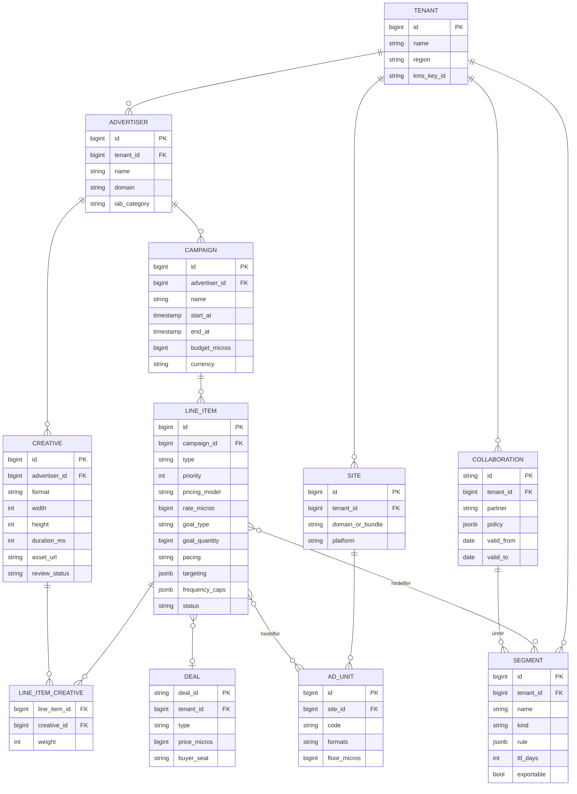

# 5. Veri Modeli

Dört ayrı depolama katmanı vardır; her biri farklı erişim desenine göre seçilmiştir:

| Depo | Kullanım | Erişim deseni |
|------|---------|---------------|
| **PostgreSQL** | Kontrol düzlemi (kampanya, line item, segment tanımı, tenant) | Düşük hacim, ilişkisel, ACID |
| **Aerospike** | Profil, idmap, fcap | Çok yüksek QPS, tek anahtar, < 1 ms |
| **ClickHouse** | Gerçek zamanlı raporlama | Kolon bazlı agregasyon, milyarlarca satır |
| **Iceberg (S3/MinIO)** | Ham olay arşivi, ML, batch segment, clean room | Büyük taramalar, zaman yolculuğu (time travel) |

## 5.1 Kontrol Düzlemi — ER Diyagramı



## 5.2 PostgreSQL DDL (Çekirdek Tablolar)

```sql
-- Para birimi değerleri her yerde "micros" (1 TRY = 1_000_000) olarak tutulur: float hatası yok.

CREATE TABLE tenants (
    id              BIGSERIAL PRIMARY KEY,
    name            TEXT        NOT NULL,
    data_region     TEXT        NOT NULL DEFAULT 'tr-ist',
    kms_key_id      TEXT        NOT NULL,
    created_at      TIMESTAMPTZ NOT NULL DEFAULT now()
);

CREATE TABLE advertisers (
    id              BIGSERIAL PRIMARY KEY,
    tenant_id       BIGINT      NOT NULL REFERENCES tenants(id),
    name            TEXT        NOT NULL,
    domain          TEXT,                      -- OpenRTB adomain / rekabet ayrımı
    iab_category    TEXT,
    created_at      TIMESTAMPTZ NOT NULL DEFAULT now()
);

CREATE TABLE campaigns (
    id              BIGSERIAL PRIMARY KEY,
    tenant_id       BIGINT      NOT NULL REFERENCES tenants(id),
    advertiser_id   BIGINT      NOT NULL REFERENCES advertisers(id),
    name            TEXT        NOT NULL,
    start_at        TIMESTAMPTZ NOT NULL,
    end_at          TIMESTAMPTZ NOT NULL,
    budget_micros   BIGINT,
    currency        CHAR(3)     NOT NULL DEFAULT 'TRY',
    status          TEXT        NOT NULL DEFAULT 'draft'
                    CHECK (status IN ('draft','active','paused','completed','archived')),
    CHECK (end_at > start_at)
);

CREATE TABLE line_items (
    id              BIGSERIAL PRIMARY KEY,
    tenant_id       BIGINT      NOT NULL REFERENCES tenants(id),
    campaign_id     BIGINT      NOT NULL REFERENCES campaigns(id),
    name            TEXT        NOT NULL,
    type            TEXT        NOT NULL CHECK (type IN
                    ('sponsorship','standard','programmatic_guaranteed',
                     'preferred_deal','price_priority','house')),
    priority        SMALLINT    NOT NULL,
    pricing_model   TEXT        NOT NULL CHECK (pricing_model IN
                    ('CPM','vCPM','CPC','CPA','CPCV','FLAT')),
    rate_micros     BIGINT      NOT NULL,
    goal_type       TEXT        CHECK (goal_type IN ('impressions','clicks','conversions','percentage','none')),
    goal_quantity   BIGINT,
    budget_micros   BIGINT,
    pacing          TEXT        NOT NULL DEFAULT 'even'
                    CHECK (pacing IN ('even','asap','front_loaded')),
    start_at        TIMESTAMPTZ NOT NULL,
    end_at          TIMESTAMPTZ NOT NULL,
    targeting       JSONB       NOT NULL DEFAULT '{}'::jsonb,   -- hedefleme DSL'i
    frequency_caps  JSONB       NOT NULL DEFAULT '[]'::jsonb,   -- [{scope,max,window}]
    deal_id         TEXT,
    status          TEXT        NOT NULL DEFAULT 'draft',
    version         INT         NOT NULL DEFAULT 1,             -- config dağıtımında optimistic versioning
    updated_at      TIMESTAMPTZ NOT NULL DEFAULT now()
);
CREATE INDEX ON line_items (tenant_id, status, start_at, end_at);

CREATE TABLE creatives (
    id              BIGSERIAL PRIMARY KEY,
    tenant_id       BIGINT      NOT NULL REFERENCES tenants(id),
    advertiser_id   BIGINT      NOT NULL REFERENCES advertisers(id),
    format          TEXT        NOT NULL CHECK (format IN ('display','video','native','audio','ctv')),
    width           INT,
    height          INT,
    duration_ms     INT,
    markup          TEXT,                      -- HTML / VAST XML / native JSON
    asset_url       TEXT,
    click_url       TEXT,
    review_status   TEXT        NOT NULL DEFAULT 'pending'
);

CREATE TABLE line_item_creatives (
    line_item_id    BIGINT NOT NULL REFERENCES line_items(id),
    creative_id     BIGINT NOT NULL REFERENCES creatives(id),
    weight          INT    NOT NULL DEFAULT 1,
    PRIMARY KEY (line_item_id, creative_id)
);

CREATE TABLE segments (
    id              BIGSERIAL PRIMARY KEY,
    tenant_id       BIGINT      NOT NULL REFERENCES tenants(id),
    name            TEXT        NOT NULL,
    kind            TEXT        NOT NULL CHECK (kind IN
                    ('realtime_rule','batch_sql','lookalike','propensity',
                     'crm_onboard','clean_room','composite','third_party')),
    rule            JSONB,
    taxonomy_ref    TEXT,                      -- ör. iab_audience_1_1:xxx
    ttl_days        INT         NOT NULL DEFAULT 30,
    exportable      BOOLEAN     NOT NULL DEFAULT true,  -- clean room segmentlerinde false
    consent_purposes TEXT[]     NOT NULL DEFAULT '{profiling,personalized_ads}',
    source_collaboration_id TEXT,
    created_at      TIMESTAMPTZ NOT NULL DEFAULT now()
);

-- Her değişiklik için değiştirilemez denetim kaydı
CREATE TABLE audit_log (
    id              BIGSERIAL PRIMARY KEY,
    tenant_id       BIGINT,
    actor           TEXT        NOT NULL,
    action          TEXT        NOT NULL,
    entity          TEXT        NOT NULL,
    entity_id       TEXT        NOT NULL,
    diff            JSONB,
    at              TIMESTAMPTZ NOT NULL DEFAULT now()
);
```

## 5.3 Profil Kaydı (Aerospike)

```text
namespace: dmp

set: idmap                         -- id → person_id çözümleme
  key : "{tenant_id}:{id_type}:{id_value}"      ör. "42:fpc:7f3a..."
  bins: person_id (string, UUIDv7)
        last_seen (int, epoch)
  TTL : 180 gün (her görüşte yenilenir)

set: profile                       -- kişi profili
  key : "{tenant_id}:{person_id}"
  bins:
    ids     : map  { "fpc:7f3a..": 1729700000, "hem:9b1c..": 1729000000, "maid:..": ... }
    seg     : map  { 10234: 1732300000, 10235: 1731000000 }        -- seg_id → expire_epoch
    fcap    : map  { "li:5512": [h0,h1,...,h23], "cmp:88": [...] }  -- saatlik kova sayaçları
    attrs   : map  { "geo_home": "istanbul", "ltv_band": 3, "lang": "tr" }
    consent : map  { "tcf": "<TC string hash>", "purposes": 0b1111111111,
                     "kvkk_explicit": true, "iys_email": false, "updated": 1729700000 }
    ver     : int                                                  -- birleştirme / optimistic lock
  TTL : 180 gün inaktivite
```

Kural: **Ad server isteği başına en fazla 2 okuma** (`idmap` + `profile`), her ikisi de aynı veri merkezinde, p99 < 1 ms.

## 5.4 Olay Şemaları (Protobuf)

```protobuf
syntax = "proto3";
package adtech.events.v1;

import "google/protobuf/timestamp.proto";

// Tüm olaylar bu zarf içinde taşınır. Kafka anahtarı: tenant_id + person_id (yoksa device id).
message EventEnvelope {
  string event_id = 1;                        // UUIDv7 (zaman sıralı) - dedup anahtarı
  google.protobuf.Timestamp event_time = 2;   // istemci zamanı
  google.protobuf.Timestamp received_time = 3;// sunucu zamanı (otorite)
  uint32 tenant_id = 4;
  Consent consent = 5;
  Identity identity = 6;
  Device device = 7;
  Context context = 8;

  oneof payload {
    // Ad server olayları
    AdRequest     ad_request    = 20;
    AdDecision    ad_decision   = 21;
    AdEvent       ad_event      = 22;
    // DMP olayları
    PageView      page_view     = 30;
    CommerceEvent commerce      = 31;
    CustomEvent   custom        = 32;
    IdentityLink  identity_link = 33;
  }
}

message Consent {
  string tcf_string = 1;
  string gpp_string = 2;
  uint64 purposes_bitmask = 3;     // normalize edilmiş amaçlar
  bool   kvkk_explicit = 4;        // KVKK açık rıza (profilleme / kişiselleştirilmiş reklam)
  bool   limit_ad_tracking = 5;
}

message Identity {
  string person_id = 1;            // çözümleme sonrası doldurulur
  repeated ExternalId ids = 2;
}

message ExternalId {
  string type = 1;                 // fpc, maid, hem, hph, ppid, uid2, id5 ...
  string value = 2;                // hem/hph her zaman hash'li gelir
}

message Device {
  string ua = 1;
  string ip_truncated = 2;         // IPv4 son oktet / IPv6 /48 maskeli saklanır
  string os = 3;
  string os_version = 4;
  string device_type = 5;          // desktop, mobile, tablet, ctv
  string country = 6;
  string region = 7;
  string city = 8;
}

message Context {
  string site_or_bundle = 1;
  string url = 2;
  string referrer = 3;
  repeated string content_categories = 4;
  string page_view_id = 5;
}

message AdRequest {
  string request_id = 1;
  string ad_unit_code = 2;
  repeated Size sizes = 3;
  string format = 4;               // display, video, native
}

message AdDecision {
  string request_id = 1;
  string impression_id = 2;
  uint64 line_item_id = 3;
  uint64 creative_id = 4;
  string winner_source = 5;        // direct, prebid, rtb, deal, house
  string bidder = 6;
  int64  price_micros = 7;
  int64  floor_micros = 8;
  string currency = 9;
  float  p_ctr = 10;
  repeated uint64 matched_segments = 11;
  uint32 candidate_count = 12;
  uint32 latency_us = 13;
  string no_fill_reason = 14;
}

message AdEvent {
  string impression_id = 1;
  string type = 2;                 // impression, viewable, click, start, q1, mid, q3, complete, conversion
  int64  value_micros = 3;         // dönüşüm değeri
  bool   ivt_flag = 4;
  string ivt_reason = 5;
}

message PageView { uint32 scroll_depth = 1; uint32 dwell_ms = 2; }

message CommerceEvent {
  string type = 1;                 // product_view, add_to_cart, purchase ...
  string order_id = 2;
  int64  revenue_micros = 3;
  string currency = 4;
  repeated Item items = 5;
}

message Item { string sku = 1; string category = 2; string brand = 3; int64 price_micros = 4; uint32 qty = 5; }
message CustomEvent { string name = 1; map<string, string> props = 2; }
message IdentityLink { ExternalId a = 1; ExternalId b = 2; string link_type = 3; float confidence = 4; }
message Size { uint32 w = 1; uint32 h = 2; }
```

## 5.5 ClickHouse Raporlama Tabloları

```sql
-- Ham reklam olayları (Flink tarafından dedup + IVT işaretli yazılır)
CREATE TABLE ads.ad_events ON CLUSTER main
(
    event_time      DateTime64(3, 'UTC'),
    event_date      Date MATERIALIZED toDate(event_time),
    tenant_id       UInt32,
    event_type      LowCardinality(String),   -- request, decision, impression, viewable, click, conversion, q1..complete
    request_id      UUID,
    impression_id   UUID,
    person_id       UUID,
    advertiser_id   UInt64,
    campaign_id     UInt64,
    line_item_id    UInt64,
    creative_id     UInt64,
    ad_unit_id      UInt64,
    site            LowCardinality(String),
    deal_id         LowCardinality(String),
    winner_source   LowCardinality(String),
    bidder          LowCardinality(String),
    country         LowCardinality(FixedString(2)),
    city            LowCardinality(String),
    device_type     LowCardinality(String),
    os              LowCardinality(String),
    price_micros    Int64,
    value_micros    Int64,
    is_ivt          UInt8,
    segments        Array(UInt64)
)
ENGINE = ReplicatedMergeTree
PARTITION BY toYYYYMMDD(event_date)
ORDER BY (tenant_id, event_type, campaign_id, line_item_id, event_time)
TTL event_date + INTERVAL 90 DAY
SETTINGS index_granularity = 8192;

-- Saatlik agrega: rapor ekranları bu tablodan beslenir (13 ay saklama)
CREATE TABLE ads.ad_stats_hourly ON CLUSTER main
(
    hour            DateTime,
    tenant_id       UInt32,
    campaign_id     UInt64,
    line_item_id    UInt64,
    creative_id     UInt64,
    ad_unit_id      UInt64,
    country         LowCardinality(FixedString(2)),
    device_type     LowCardinality(String),
    impressions     AggregateFunction(sum, UInt64),
    viewables       AggregateFunction(sum, UInt64),
    clicks          AggregateFunction(sum, UInt64),
    conversions     AggregateFunction(sum, UInt64),
    revenue_micros  AggregateFunction(sum, Int64),
    reach           AggregateFunction(uniqCombined64, UUID)
)
ENGINE = ReplicatedAggregatingMergeTree
PARTITION BY toYYYYMM(hour)
ORDER BY (tenant_id, hour, campaign_id, line_item_id, creative_id, ad_unit_id, country, device_type)
TTL hour + INTERVAL 13 MONTH;

CREATE MATERIALIZED VIEW ads.mv_ad_stats_hourly ON CLUSTER main
TO ads.ad_stats_hourly AS
SELECT
    toStartOfHour(event_time)                         AS hour,
    tenant_id, campaign_id, line_item_id, creative_id, ad_unit_id, country, device_type,
    sumState(toUInt64(event_type = 'impression'))     AS impressions,
    sumState(toUInt64(event_type = 'viewable'))       AS viewables,
    sumState(toUInt64(event_type = 'click'))          AS clicks,
    sumState(toUInt64(event_type = 'conversion'))     AS conversions,
    sumState(if(event_type = 'impression', price_micros, 0)) AS revenue_micros,
    uniqCombined64StateIf(person_id, event_type = 'impression') AS reach
FROM ads.ad_events
WHERE is_ivt = 0
GROUP BY hour, tenant_id, campaign_id, line_item_id, creative_id, ad_unit_id, country, device_type;
```

> Not: Gelir, "impression" olayındaki `price_micros` üzerinden hesaplanır (CPM / 1000 karşılığı olarak Flink'te gösterim başına fiyata çevrilmiş olmalıdır). CPC/CPA modellerinde gelir, ilgili click/conversion olayına yazılır.

## 5.6 Kafka Topic Tasarımı

| Topic | Anahtar | Partition | Saklama | Not |
|-------|--------|-----------|---------|-----|
| `raw.web_events` | tenant+device | 96 | 3 gün | Collector çıkışı |
| `raw.s2s_events` | tenant+external_id | 24 | 3 gün | S2S API |
| `enriched.events` | tenant+person | 96 | 7 gün | Flink zenginleştirme çıkışı |
| `ad.decisions` | tenant+request | 128 | 3 gün | Ad server async log |
| `ad.events` | tenant+impression | 64 | 7 gün | Tracking |
| `dmp.segment_changes` | tenant+person | 48 | 3 gün | Üyelik değişiklikleri |
| `identity.merges` | tenant+person | 24 | 30 gün | Person birleştirme olayları |
| `config.adserver` | tenant | 12 | compacted | Line item snapshot/delta |
| `control.pacing` | line_item | 12 | compacted | Throttle oranları |
| `privacy.dsar` | tenant+person | 12 | 30 gün | Silme / erişim talepleri |
| `dlq.*` | — | 6 | 14 gün | Hatalı olaylar |
