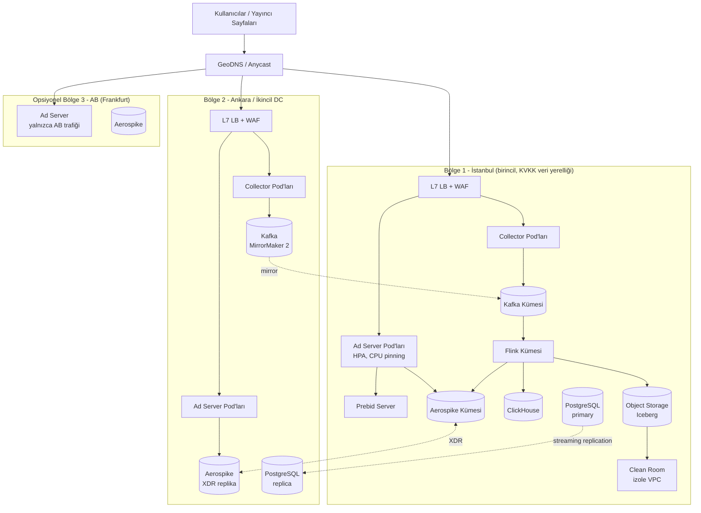

# 6. Altyapı ve Teknoloji

## 6.1 Teknoloji Yığını

| Alan | Seçim | Alternatif | Gerekçe |
|------|-------|-----------|---------|
| Ad server hot path | **Go** | Rust / C++ | Düşük gecikme, kolay işe alım, iyi eşzamanlılık; GC baskısını azaltmak için nesne havuzları ve sıfır-kopya parse |
| Event collector | **Go** | Rust, Vector | Stateless, yatay ölçek |
| Header bidding | **Prebid Server (Go)** | — | Sektör standardı, 200+ bidder adaptörü |
| Mesajlaşma | **Apache Kafka (KRaft)** | Redpanda | Ekosistem, exactly-once, Flink entegrasyonu |
| Şema | **Protobuf + Schema Registry** | Avro | Hızlı serileştirme, Go/Java desteği |
| Stream işleme | **Apache Flink** | Kafka Streams | Büyük keyed state, event-time, exactly-once |
| Profil / KV | **Aerospike** | ScyllaDB, Redis Cluster | AdTech standardı, SSD üzerinde < 1 ms |
| OLAP | **ClickHouse** | Druid, Pinot | Hız, maliyet, SQL |
| Lakehouse | **Apache Iceberg + S3/MinIO** | Delta Lake | Açık format, time travel, şema evrimi |
| Batch / sorgu | **Spark + Trino** | — | Identity graph, batch segment, ad-hoc |
| Orkestrasyon | **Dagster / Airflow** | — | Batch DAG'ler |
| Kontrol düzlemi DB | **PostgreSQL** | — | İlişkisel, CDC (Debezium) |
| ML | **LightGBM, PyTorch, ONNX Runtime, Feast, MLflow** | — | Model ad server içine ONNX olarak gömülür |
| Vektör / ANN | **FAISS / ScaNN** (batch), **Qdrant** (online) | — | Lookalike |
| Sketch | **Apache DataSketches** | — | Erişim / örtüşme tahmini |
| DP | **OpenDP / Google DP kütüphanesi** | Tumult Analytics | Clean room gürültüsü |
| Gizli hesaplama | **AMD SEV-SNP / Intel TDX gizli VM'ler** | — | Clean room |
| Konteyner | **Kubernetes** | — | Ad server için ayrı node pool, CPU pinning |
| IaC / GitOps | **Terraform + Argo CD** | — | — |
| Gözlemlenebilirlik | **OpenTelemetry, Prometheus, Grafana, Loki, Tempo** | — | — |
| Sırlar / anahtar | **HashiCorp Vault + bulut KMS / HSM** | — | Tenant başına anahtar |
| Frontend | **React + TypeScript** | — | Admin UI |
| API | **REST (OpenAPI) + GraphQL** | gRPC (iç servisler) | — |

## 6.2 Dağıtım Topolojisi

- **Aktif-aktif ad serving:** Her bölge kendi profil replikası ile bağımsız karar verir; config tüm bölgelere yayınlanır.
- **Olaylar merkezde toplanır:** Bölge 2 olayları MirrorMaker 2 ile birincil bölgeye akar; raporlama ve batch tek yerde.
- **AB trafiği:** GDPR kapsamında AB kullanıcılarının verisinin AB'de işlenmesi gerekiyorsa ayrı bölge; KVKK kapsamında Türkiye verisi Türkiye'de tutulur (yurtdışı aktarım kısıtlarını basitleştirir).

## 6.3 Gecikme Bütçesi (Ad Request, Direct Karar)

| Adım | Hedef p99 |
|------|-----------|
| TLS sonlandırma + LB | 2 ms |
| İstek parse + doğrulama + rıza kontrolü | 0.5 ms |
| GeoIP + UA parse (bellek içi) | 0.3 ms |
| `idmap` + `profile` okuma (Aerospike, paralel) | 2 ms |
| Targeting index aday çekme | 1 ms |
| Filtreler (fcap, pacing, brand safety) | 1 ms |
| ML skorlama (ONNX, in-process, batch) | 2 ms |
| Açık artırma + kreatif hazırlama | 1 ms |
| Yanıt serileştirme | 0.2 ms |
| **Toplam (sunucu içi)** | **< 10 ms p50, < 30 ms p99** |

Header bidding / RTB içeren isteklerde toplam süre bidder timeout'u ile belirlenir (tipik 100–300 ms); bu süre boyunca profil okuma ve aday hesaplama **paralel** yürür.

**Performans pratikleri:**
- Sıcak yolda bellek tahsisini (allocation) minimize et: `sync.Pool`, önceden ayrılmış buffer'lar, sıfır-kopya JSON / Protobuf.
- Tüm dış çağrılarda **sıkı timeout + circuit breaker + fallback** (profil okunamazsa kontekstüel karar ver; reklam her zaman dönsün).
- Line item config'i immutable snapshot olarak tut; güncellemede atomic pointer swap (lock-free okuma).
- Ad server pod'larını ayrı node pool'da, `Guaranteed` QoS ve CPU pinning ile çalıştır; GOGC / GOMEMLIMIT ayarı.

## 6.4 Kapasite Tahmini (Örnek)

Varsayım: ortalama 20K, tepe 60K ad request/sn; istek başına ~3 olay; olay başına ~1.5 KB (Protobuf, sıkıştırmasız); 100M aktif profil.

| Kalem | Hesap | Sonuç |
|-------|------|-------|
| Tepe olay hacmi | 60K × 3 × 1.5 KB | ~270 MB/s |
| Günlük ham olay | 20K × 3 × 1.5 KB × 86 400 | ~7.8 TB/gün |
| Kafka (3 gün, RF=3, zstd ~4×) | 7.8 × 3 × 3 / 4 | ~18 TB disk |
| ClickHouse ham (90 gün, ~10× sıkıştırma) | 7.8 / 10 × 90 | ~70 TB (replika hariç) |
| Profil deposu | 100M × 2 KB × RF 2 | ~400 GB SSD + ~13 GB RAM indeks |
| Ad server CPU | ~1.5 ms CPU/istek × 60K | ~90 vCPU (+%50 pay → ~135 vCPU) |

> Bu tablo bir başlangıç noktasıdır; gerçek değerler yük testleriyle (k6 / Gatling, gerçek trafik replay) doğrulanmalıdır.

## 6.5 SLO'lar

| Servis | SLI | SLO |
|--------|-----|-----|
| Ad Decision API | Başarılı yanıt oranı | %99.95 |
| Ad Decision API | Sunucu içi gecikme | p99 < 30 ms |
| Event Collector | Kabul edilen olay oranı | %99.99 |
| Uçtan uca olay kaybı | Collector → Iceberg mutabakatı | < %0.01 |
| Raporlama tazeliği | Olay → ClickHouse | < 5 dk |
| Segment tazeliği (gerçek zamanlı) | Olay → profil üyeliği | < 30 sn (p95) |
| Pacing doğruluğu | Gün sonu teslimat / hedef | %98–102 |
| DSAR silme | Talep → tüm depolardan silme | < 30 gün (hedef 72 saat) |

## 6.6 Gözlemlenebilirlik

- **Metrikler:** istek/sn, fill rate, no-fill nedenleri, bidder timeout oranı, karar gecikmesi histogramı, Aerospike gecikmesi, Kafka consumer lag, Flink checkpoint süresi, pacing hatası.
- **İş metrikleri alarmları:** gelirde ani düşüş (saatlik, geçen haftanın aynı saatine göre), IVT oranında sıçrama, line item'ın beklenmedik şekilde teslimat yapmaması.
- **Tracing:** Örneklemeli (%0.1) OpenTelemetry trace; ad server'da her isteğe `request_id`.
- **Debug modu:** Belirli bir istek için "neden bu reklam / neden reklam yok" açıklaması (eleme nedenleri listesi) — kampanya operasyonları için kritik.

## 6.7 Güvenlik

- Tüm servisler arası **mTLS** (service mesh / SPIFFE kimlikleri).
- PII (ham email/telefon) **asla** ana sisteme girmez; istemci veya edge'de hash'lenir. Ham PII gerektiren tek yer ayrı **PII Vault** (erişim loglu, ayrı anahtar).
- IP adresleri olay kaydında maskeli (IPv4 /24, IPv6 /48) saklanır; tam IP yalnızca IVT için kısa süreli (ör. 7 gün) ayrı tabloda.
- Tenant başına envelope encryption; anahtar rotasyonu.
- Admin UI: SSO (OIDC), MFA, RBAC + kayıt seviyesinde yetki (ABAC).
- Tedarik zinciri: imzalı konteyner imajları, SBOM, bağımlılık taraması.
- Düzenli sızma testi; ISO 27001 hedefi.

## 6.8 CI/CD ve Test Stratejisi

- **Ad server sürümleri:** canary (%1 → %10 → %50 → %100), otomatik geri alma kriterleri: hata oranı, gecikme, fill rate, gelir/istek sapması.
- **Shadow trafik:** Yeni karar mantığı canlı trafiğin kopyasıyla çalışır, sonuç karşılaştırılır, yanıt dönmez.
- **Replay testleri:** Kaydedilmiş gerçek isteklerle deterministik karar testi.
- **A/B altyapısı:** Açık artırma, floor, model değişiklikleri için kullanıcı bazlı deney bölmeleri (experiment framework) ve gelir/kullanıcı deneyimi metrikleri.
- **Sözleşme testleri:** Protobuf şema uyumluluğu CI'da zorunlu (breaking change engeli).
