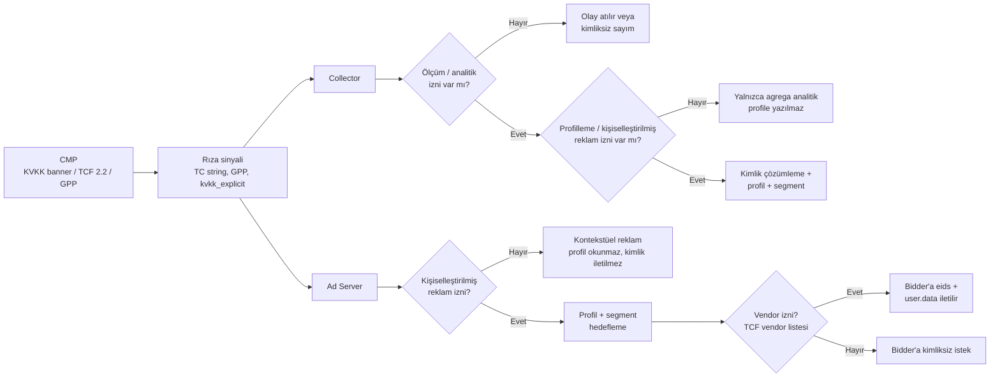
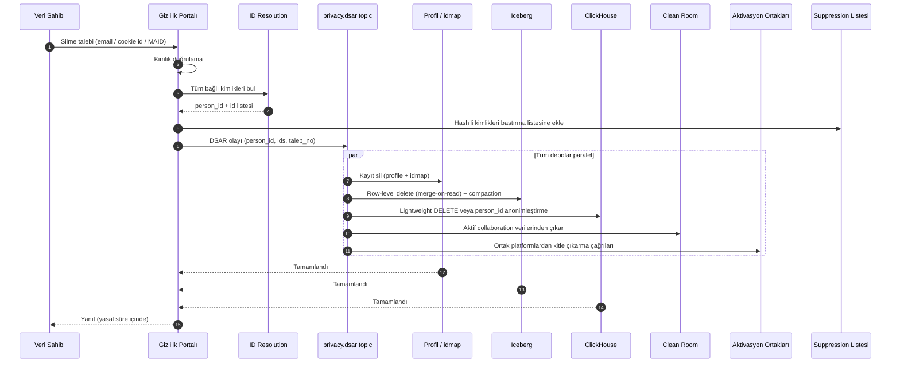

# 7. Gizlilik ve Uyum

> Bu bölüm mimari gereksinimleri tanımlar; hukuki görüş değildir. Uygulamaya geçmeden önce KVKK/GDPR konusunda uzman bir hukuk danışmanıyla doğrulanmalıdır.

## 7.1 Düzenleyici Çerçeve

| Düzenleme / Standart | Mimarideki karşılığı |
|----------------------|----------------------|
| **KVKK (6698 sayılı Kanun)** | Pazarlama/profilleme amaçlı çerezler ve kişiselleştirilmiş reklam için **açık rıza**; aydınlatma metni; VERBİS kaydı; veri sahibi taleplerine 30 gün içinde yanıt; ihlal bildirimi (72 saat) |
| **KVKK Çerez Rehberi** | Zorunlu çerezler dışındaki (analitik, pazarlama) çerezler rıza alınmadan yazılmaz; "tümünü reddet" seçeneği eşit kolaylıkta |
| **KVKK m.9 — yurtdışı aktarım** (2024 değişikliği) | Yeterlilik kararı yoksa standart sözleşme vb. uygun güvenceler; **varsayılan: Türkiye verisi Türkiye'de** işlenir, yurtdışı bidder/partnerlere gönderilen veri minimize edilir |
| **Kişisel Verilerin Silinmesi, Yok Edilmesi veya Anonim Hale Getirilmesi Yönetmeliği** | Saklama ve imha politikası; periyodik imha (en geç 6 ayda bir) |
| **6563 sayılı Kanun + İYS** | Email/SMS aktivasyonunda İYS'de onayı olmayan alıcılar filtrelenir |
| **GDPR + ePrivacy** (AB kullanıcıları) | Rıza / meşru menfaat ayrımı, DPIA (büyük ölçekli profilleme), itiraz hakkı, veri işleyen sözleşmeleri |
| **IAB TCF 2.2 / GPP** | Rıza dizesinin okunması, taşınması ve OpenRTB `regs` / `user.consent` alanlarıyla iletilmesi |
| **Apple ATT / Google Play politikaları** | MAID yalnızca izin varsa; SKAdNetwork / AdAttributionKit desteği |

## 7.2 Rıza (Consent) Akışı

**Kurallar:**
- Rıza durumu her olayla birlikte taşınır (`Consent` mesajı); downstream servisler kendi kararını bu alanla verir — "rıza geldi mi?" diye merkezi servise sorulmaz.
- Profilde son rıza durumu saklanır; rıza geri çekilirse (`consent_withdrawn` olayı) profil anında "kişiselleştirme kapalı" moduna alınır ve segment üyelikleri silinir.
- Rıza kayıtları (ne zaman, hangi metin sürümü, hangi kanal) ispat amaçlı ayrı ve değiştirilemez şekilde saklanır.

## 7.3 Veri Sahibi Talepleri (DSAR) — Silme Akışı

- **Suppression listesi** sayesinde silinen kişi, eski bir cookie ile tekrar gelse bile profil yeniden oluşturulmaz.
- Her talep için tamamlanma kanıtı (hangi depo, ne zaman) saklanır.

## 7.4 Saklama Süreleri (Öneri)

| Veri | Saklama | Gerekçe |
|------|---------|---------|
| Ham DMP olayları (Iceberg) | 13 ay | Yıllık karşılaştırma, model eğitimi |
| Ham reklam olayları (ClickHouse) | 90 gün | Detaylı rapor, uyuşmazlık |
| Agrega raporlar | 25 ay | Faturalama, sözleşme |
| Profil kaydı | 180 gün inaktivite | Veri minimizasyonu |
| Segment üyeliği | Segment TTL'i (genelde 30–90 gün) | Güncellik |
| Tam IP adresi | 7 gün | Yalnızca IVT tespiti |
| Clean room match tablosu | Collaboration süresi + 30 gün | Sözleşme |
| Rıza kayıtları | İlişki süresi + yasal zamanaşımı | İspat yükü |
| Faturalama verisi | Yasal (vergi) süre | Mevzuat |

## 7.5 Gizliliği Artıran Teknik Önlemler (PETs)

| Önlem | Nerede |
|-------|-------|
| İstemci / edge tarafında hash'leme (SHA-256) | Email, telefon |
| Takma adlandırma (pseudonymization) — `person_id` | Tüm sistem |
| IP maskeleme | Olay kayıtları |
| k-anonimlik eşiği | Raporlar (küçük hücreler bastırılır), clean room |
| Diferansiyel gizlilik | Clean room çıktıları, dış raporlar |
| PSI / TEE | Clean room eşleştirme |
| Crypto-shredding | Tenant ayrılışı, collaboration bitişi |
| Veri minimizasyonu | Bidder'lara yalnızca gerekli alanlar; yurtdışı bidder'lara kimlik gönderiminin politika ile kısıtlanması |

## 7.6 Cookieless Strateji

Safari (ITP) ve Firefox (ETP) 3. parti cookie'leri zaten engelliyor; Chrome tarafındaki politikalar ve Privacy Sandbox API'lerinin geleceği ise defalarca değişti. Bu nedenle mimari **hiçbir kritik fonksiyonu 3. parti cookie'ye bağlamaz**:

1. **1. parti kimlik + login (PPID, hashed email)** — en değerli sinyal; yayıncılarda login oranını artıracak ürün kurgusu önerilir.
2. **Kontekstüel hedefleme** — sayfa içeriği sınıflandırma (NLP), rıza gerektirmeden çalışır.
3. **Ortak kimlik çözümleri** (UID2, ID5 vb.) — OpenRTB `user.eids` ile bidder'lara aktarım.
4. **Seller-Defined Audiences / curated deal'ler** — kimlik paylaşmadan kitle değerini satmak.
5. **Clean room** — reklamveren 1P verisiyle kimlik paylaşmadan eşleşme.
6. **Modellenmiş ölçümleme** — kimliksiz trafikte agrega/istatistiksel atıflama (MMM, incrementality testleri).
