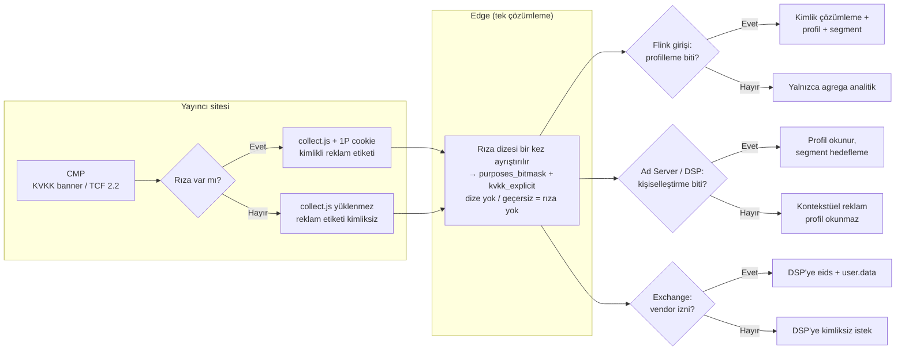
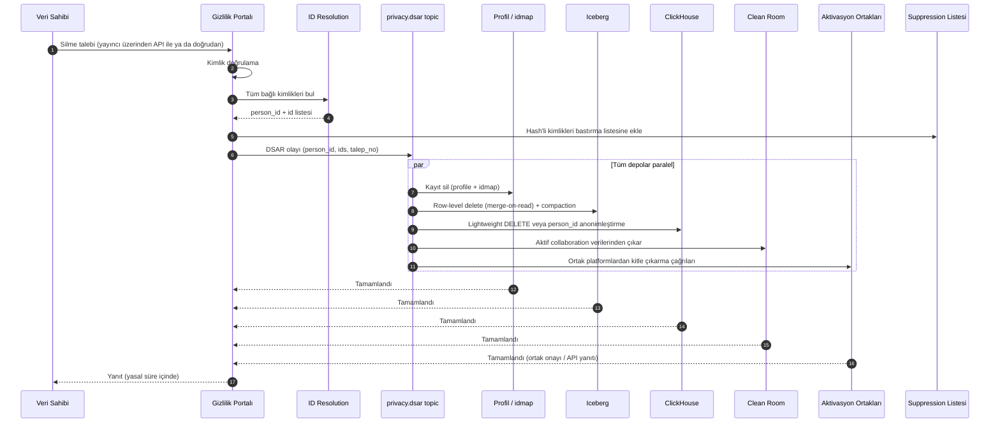

# 7. Gizlilik ve Uyum

> Bu bölüm mimari gereksinimleri tanımlar; hukuki görüş değildir. Uygulamaya geçmeden önce KVKK/GDPR konusunda uzman bir hukuk danışmanıyla doğrulanmalıdır.

## 7.1 Düzenleyici Çerçeve

| Düzenleme / Standart | Mimarideki karşılığı |
|----------------------|----------------------|
| **KVKK (6698 sayılı Kanun)** | Pazarlama/profilleme amaçlı çerezler ve kişiselleştirilmiş reklam için **açık rıza**; aydınlatma metni; VERBİS kaydı; veri sahibi taleplerine 30 gün içinde yanıt; ihlal bildirimi (72 saat) |
| **KVKK Çerez Rehberi** | Zorunlu çerezler dışındaki (analitik, pazarlama) çerezler rıza alınmadan yazılmaz; "tümünü reddet" seçeneği eşit kolaylıkta |
| **KVKK m.9 — yurtdışı aktarım** (2024 değişikliği) | Yeterlilik kararı yoksa standart sözleşme vb. uygun güvenceler; **varsayılan: Türkiye verisi Türkiye'de** işlenir, yurtdışı bidder/partnerlere gönderilen veri minimize edilir |
| **Kişisel Verilerin Silinmesi, Yok Edilmesi veya Anonim Hale Getirilmesi Yönetmeliği** | Saklama ve imha politikası; periyodik imha (en geç 6 ayda bir) |
| **6563 sayılı Kanun + İYS** | Email/SMS aktivasyonunda İYS'de onayı olmayan alıcılar filtrelenir |
| **GDPR + ePrivacy** (AB kullanıcıları) | Rıza / meşru menfaat ayrımı, DPIA (büyük ölçekli profilleme), itiraz hakkı, veri işleyen sözleşmeleri |
| **IAB TCF 2.2 / GPP** | Rıza dizesinin okunması, taşınması ve OpenRTB `regs` / `user.consent` alanlarıyla iletilmesi |
| **Apple ATT / Google Play politikaları** | MAID yalnızca izin varsa; SKAdNetwork / AdAttributionKit desteği |

## 7.2 Rıza (Consent): Sorumluluk ve Akış

**Temel ilke: rızayı yayıncı alır, platform uygular.** Rıza yayıncının sitesinde, yayıncının CMP'si ve aydınlatma metniyle alınır. Platform rızayı toplamaz, değiştirmez ve saklamaz; gelen sinyali **edge'de bir kez çözer**, sonraki katmanlar yalnızca bu sonucu okur.

### 7.2.1 Sorumluluk ayrımı

| Konu | Yayıncı (site) | Platform (biz) |
|------|----------------|----------------|
| Rıza ekranı (KVKK banner / CMP), aydınlatma metni | Sorumlu | Kendi adımıza metin sağlar; CMP'de taraf olarak listelenir |
| Zorunlu olmayan çerez ve etiketlerin rızadan önce çalışmaması | Sorumlu: rıza yoksa `collect.js` yüklenmez, çerez yazılmaz, reklam etiketi kimlik göndermez | — |
| Rıza ispatı (ne zaman, hangi metin sürümü, hangi kanal) | CMP kayıtlarında tutar | Tutmaz; yalnızca olayla gelen rıza bit maskesini saklar ("sinyale uyduk" kanıtı) |
| Rıza sinyaline uymak | — | Sorumlu: kişiselleştirme, profil, kimlik iletimi sinyale göre açılır / kapanır |
| Silme talepleri | Talebin ilk muhatabı; bizim API'mize iletir | Talebi tüm depolarda uygular (7.3) |

- **Platformun rolü:** Yalnızca yayıncının kendi reklam sunucusu olarak çalıştığımız durumda veri işleyen konumundayız. Kendi DMP ve DSP'mizle veriyi birden çok yayıncı arasında kullandığımızda kendi amacımızla da işliyoruz; bu yüzden yayıncının CMP'si platformu ayrı bir taraf (TCF'de vendor) olarak göstermeli ve rızayı bizim adımıza da almalıdır. Rol (veri sorumlusu / veri işleyen / ortak) sözleşme ve hukuk danışmanıyla netleştirilir.
- **CMP kararı (ürün):** Türkiye ağındaki yayıncılara kendi CMP'mizi vermek bir seçenektir; bu durumda rıza kayıtlarını teknik olarak biz tutarız, ama rıza yine yayıncı adına alınmış olur. Vermezsek yayıncıdan TCF uyumlu bir CMP kullanmasını ve platformu listelemesini sözleşmede şart koşarız.

### 7.2.2 Akış

### 7.2.3 Uygulama kuralları (gereksiz işlem yapmamak için)
- **Tek çözümleme:** Rıza dizesi yalnızca edge'de (Gateway / Collector) ayrıştırılır ve olay zarfındaki `Consent` mesajına bit maskesi olarak yazılır (`purposes_bitmask`, `kvkk_explicit`). Sonraki servisler dizeyi yeniden ayrıştırmaz, merkezi bir rıza servisine sormaz; yalnızca biti okur.
- **Kapalı varsayılan:** Dize yoksa ya da geçersizse rıza yok sayılır.
- **Karar noktaları yalnızca bunlardır:**
  - Ad Server ve DSP: kişiselleştirme biti kapalıysa profil okunmaz (Aerospike okuması atlanır; rıza işi azaltır, artırmaz).
  - Exchange: vendor izni yoksa harici DSP'ye giden istekten `user.eids` ve `user.data` tek bir fonksiyonla çıkarılır.
  - Flink girişi: profilleme biti açıksa kimlik çözümleme ve profil yolu, kapalıysa yalnızca agrega.
- **Sonraki katmanlarda yeniden kontrol yok:** Segment motoru, aktivasyon, clean room ve raporlama, Flink girişinde süzülmüş veriyle çalışır; ayrıca rıza kontrolü yapmaz.
- **Collector'da ayrıntılı mantık yok:** Site doğru çalışıyorsa rızasız kimlikli olay gelmez. Collector yalnızca tek satırlık bir koruma uygular (gerekli bit yoksa kimlik alanlarını atar); bu, yanlış yapılandırılmış sitelere karşı ikinci savunma hattıdır.
- **Geri çekme:** Rıza geri çekilince `collect.js` artık yüklenmediği için olayı o gönderemez. Bu yüzden CMP'nin geri çekme callback'i yayıncının sayfasından **tek seferlik ve yalnızca kimlik taşıyan** bir `consent_withdrawn` ping'i gönderir (yayıncının CMP entegrasyonunda zorunlu; tek amacı silme). Ping profili "kişiselleştirme kapalı" moduna alır ve segment üyeliklerini siler. Ping hiç gelmezse kişi 180 günlük profil TTL'iyle düşer. Periyodik yeniden kontrol yapılmaz.
- **Fingerprint yok:** Rıza olmadan kullanıcıyı tanımak için cihaz sinyallerinden (IP, UA, ekran, yazı tipi) kimlik türetilmez; bu, rıza kuralını dolanmak olur. Cihaz sinyalleri yalnızca IVT tespitinde, istek anında kullanılır ([3.3](03-dmp.md#33-kimlik-çözümleme-identity-resolution)).
- **TCF yalnızca gerekince:** Türkiye trafiğinde yalnızca KVKK banner'ı kullanılıyorsa vendor kararı yayıncı sözleşmesindeki statik bir ayara iner (harici DSP'ye kimlik gönder / gönderme). TCF / GPP ayrıştırması AB trafiği için devreye girer.

## 7.3 Veri Sahibi Talepleri (DSAR) — Silme Akışı

- **Talep kanalı:** Ziyaretçi talebini çoğunlukla yayıncıya iletir; yayıncı bunu platformun DSAR API'sine (talep no, kimlikler) gönderir. Kendi rolümüzde (çapraz yayıncı DMP / DSP) doğrudan gelen talepler de Gizlilik Portalı'ndan alınır.
- **Suppression listesi** sayesinde silinen kişi, eski bir cookie ile tekrar gelse bile profil yeniden oluşturulmaz. Kişi silme talebinden sonra CMP'de **yeniden açık rıza** verirse (rıza zaman damgası talepten yeni) bastırma kaldırılır ve yeni bir profil başlar.
- Her talep için tamamlanma kanıtı (hangi depo, ne zaman) saklanır.

## 7.4 Saklama Süreleri (Öneri)

| Veri | Saklama | Gerekçe |
|------|---------|---------|
| Ham DMP olayları (Iceberg) | 13 ay | Yıllık karşılaştırma, model eğitimi |
| Ham reklam olayları (ClickHouse) | 90 gün | Detaylı rapor, uyuşmazlık |
| Agrega raporlar | 25 ay | Faturalama, sözleşme |
| Profil kaydı | 180 gün inaktivite | Veri minimizasyonu |
| Segment üyeliği | Segment TTL'i (genelde 30–90 gün) | Güncellik |
| Tam IP adresi | 7 gün | Yalnızca IVT tespiti |
| Clean room match tablosu | Collaboration süresi + 30 gün | Sözleşme |
| Rıza bit maskesi (olayla birlikte) | Olayın saklama süresi | Sinyale uyulduğunun kanıtı; rıza ispat kayıtları yayıncının CMP'sinde tutulur (7.2.1) |
| Faturalama verisi | Yasal (vergi) süre | Mevzuat |

## 7.5 Gizliliği Artıran Teknik Önlemler (PETs)

| Önlem | Nerede |
|-------|-------|
| İstemci / edge tarafında hash'leme (SHA-256) | Email, telefon |
| Takma adlandırma (pseudonymization) — `person_id` | Tüm sistem |
| IP maskeleme | Olay kayıtları |
| k-anonimlik eşiği | Raporlar (küçük hücreler bastırılır), clean room |
| Diferansiyel gizlilik | Clean room çıktıları, dış raporlar |
| PSI / TEE | Clean room eşleştirme |
| Crypto-shredding | Tenant ayrılışı, collaboration bitişi |
| Veri minimizasyonu | Bidder'lara yalnızca gerekli alanlar; yurtdışı bidder'lara kimlik gönderiminin politika ile kısıtlanması |
| Fingerprinting yasağı | Kimlik yalnızca deterministik kaynaklardan (cookie, MAID, hashed email, PPID, UID2); cihaz sinyalleri yalnızca IVT için, kalıcı kimliğe dönüştürülmeden |

## 7.6 Cookieless Strateji

Safari (ITP) ve Firefox (ETP) 3. parti cookie'leri zaten engelliyor; Chrome tarafındaki politikalar ve Privacy Sandbox API'lerinin geleceği ise defalarca değişti. Bu nedenle mimari **hiçbir kritik fonksiyonu 3. parti cookie'ye bağlamaz**:

1. **1. parti kimlik + login (PPID, hashed email)** — en değerli sinyal; yayıncılarda login oranını artıracak ürün kurgusu önerilir.
2. **Kontekstüel hedefleme** — sayfa içeriği sınıflandırma (NLP), rıza gerektirmeden çalışır.
3. **Ortak kimlik çözümleri** (UID2, ID5 vb.) — OpenRTB `user.eids` ile bidder'lara aktarım.
4. **Seller-Defined Audiences / curated deal'ler** — kimlik paylaşmadan kitle değerini satmak.
5. **Clean room** — reklamveren 1P verisiyle kimlik paylaşmadan eşleşme.
6. **Modellenmiş ölçümleme** — kimliksiz trafikte agrega/istatistiksel atıflama (MMM, incrementality testleri).
