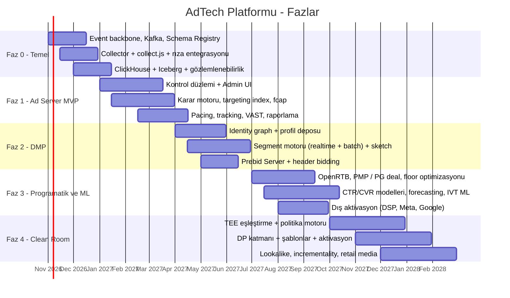

# 8. Yol Haritası ve Ekip

## 8.1 Fazlar

## 8.2 Faz Detayları

### Faz 0 — Temel (≈ 2–3 ay)
- Kafka + Schema Registry + Protobuf olay sözleşmeleri.
- Event Collector (Go) + `collect.js` + CMP entegrasyonu (KVKK banner, TCF 2.2).
- Flink zenginleştirme hattı, Iceberg ve ClickHouse.
- Kubernetes, Terraform, CI/CD, gözlemlenebilirlik temeli.
- **Çıktı:** Olaylar uçtan uca, ölçülebilir kayıpla akıyor; temel trafik raporları.

### Faz 1 — Ad Server MVP (≈ 3–4 ay)
- Reklamveren / kampanya / line item / kreatif yönetimi (UI + API).
- Karar motoru: targeting index, öncelik katmanları, fcap, even pacing.
- Display + VAST video, imzalı tracking, dedup, GIVT filtresi.
- Saatlik raporlama (ClickHouse), "neden bu reklam" debug aracı.
- **Çıktı:** Doğrudan satış kampanyaları canlı trafikte teslim ediliyor.

### Faz 2 — DMP (≈ 3 ay)
- Identity graph (deterministik), `idmap`, profil deposu.
- Gerçek zamanlı + batch segment motoru, segment DSL, Theta sketch ile erişim tahmini.
- Ad server'da segment hedefleme; Prebid Server ile header bidding.
- **Çıktı:** 1P kitle hedefleme ve birleşik açık artırma.

### Faz 3 — Programatik ve ML (≈ 4 ay)
- OpenRTB 2.6, PMP / PG deal'ler, dinamik floor.
- pCTR / pCVR modelleri, garantili teslimat için allocation plan, envanter forecast.
- SIVT ML modeli, marka güvenliği entegrasyonları.
- Dış aktivasyon: DSP segment push, Meta / Google hashed kitleler.
- **Çıktı:** Gelir optimizasyonu ve tam programatik yığın.

### Faz 4 — Clean Room ve İleri Ölçümleme (≈ 4–6 ay)
- Gizli VM üzerinde clean room, Uploader CLI, PSI.
- Politika motoru, sorgu şablonları, DP bütçe yönetimi, audit.
- Opak segment aktivasyonu, satış lift / incrementality, retail media kapalı döngü ölçümleme.
- Lookalike ve propensity segmentleri.
- **Çıktı:** Reklamverenlerle gizlilik korumalı veri işbirliği.

## 8.3 MVP'de Bilinçli Olarak Ertelenenler
- Olasılıksal kimlik eşleştirme
- CTV / SSAI
- Çoklu para birimi otomatik kur dönüşümü (MVP: TRY + USD sabit kur tablosu)
- Self-servis reklamveren paneli (MVP: yalnızca operasyon ekibi)
- Çok bölgeli aktif-aktif (MVP: tek bölge + felaket kurtarma yedeği)

## 8.4 Ekip Yapısı (Önerilen)

| Ekip | Rol | Kişi (yaklaşık) |
|------|-----|-----------------|
| **Ad Serving** | Go/Rust backend, düşük gecikme uzmanlığı | 4–6 |
| **Programmatic** | OpenRTB, Prebid, SSP/DSP entegrasyonları | 2–3 |
| **Data Platform** | Kafka, Flink, ClickHouse, Iceberg | 3–4 |
| **DMP / Identity** | Identity graph, segment motoru | 3 |
| **ML** | CTR/CVR, IVT, forecast, lookalike | 2–3 |
| **Clean Room / Privacy Eng.** | Kriptografi, TEE, DP | 2 |
| **Control Plane / Frontend** | Admin UI, API | 3 |
| **SRE / Platform** | Kubernetes, gözlemlenebilirlik, güvenlik | 2–3 |
| **Ürün / Ad Ops / Hukuk** | Ürün yönetimi, kampanya operasyonu, KVKK uyumu (DPO) | 3–4 |

## 8.5 Başarı Metrikleri (KPI)

- **Fill rate** ve **eCPM** artışı (mevcut çözüme göre)
- 1P kimlik oranı (kimliği çözülmüş istek yüzdesi)
- Segment eşleşme oranı ve segmentli kampanyaların CTR/CVR farkı
- Garantili kampanyalarda teslimat doğruluğu (%98–102)
- IVT oranı
- Clean room collaboration sayısı ve ölçülen lift
- Altyapı maliyeti / 1000 istek
