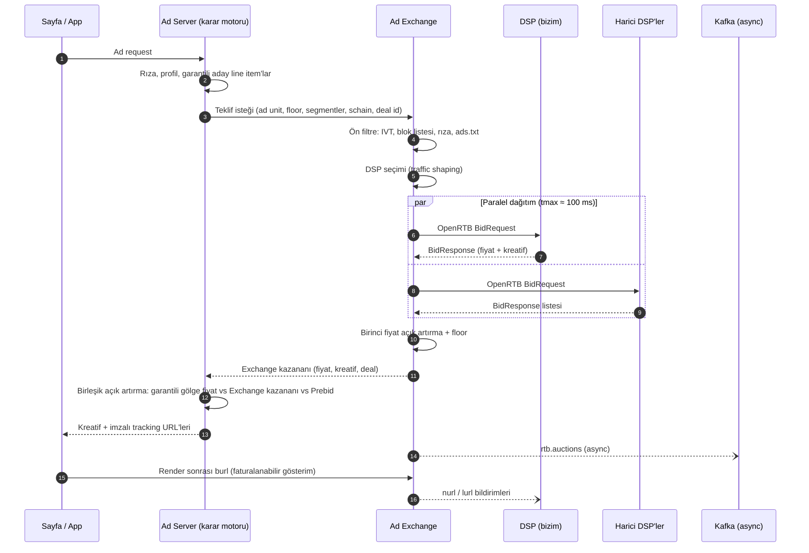

# 9. Ad Exchange ve DSP

[Ad Server](02-ad-server.md) bölümü yayıncı (arz) tarafını anlatır. Platform yalnızca kendi envanterini satan bir ad server değil, alıcı ile satıcıyı buluşturan bir **pazar yeri** olarak tasarlanır. Bu bölüm o pazar yerinin iki parçasını tanımlar:

- **Ad Exchange:** Yayıncının satışa açtığı her gösterimi gerçek zamanlı açık artırmaya çıkarır ve teklif isteğini DSP'lere dağıtır.
- **Kendi DSP'miz:** Reklamverenlerin self-servis panelden kampanya kurup her teklif isteğine fiyat verdiği talep tarafı ürünüdür.

Harici DSP'ler Exchange'e OpenRTB 2.6 ile bağlanır. Kendi DSP'miz de Exchange'e **harici bir DSP gibi** bağlanır.

## 9.1 Roller ve Sınırlar

| Bileşen | Taraf | Sorumluluk | Kim kullanır |
|---------|-------|-----------|--------------|
| **Ad Server + SSP** | Arz | Envanteri tanımlar, doğrudan kampanyaları yönetir, son kararı verir ([2](02-ad-server.md)) | Yayıncı, ad ops |
| **Ad Exchange** | Pazar yeri | Teklif isteğini dağıtır, açık artırmayı yürütür, komisyonu kaydeder | Platform |
| **DSP (bizim)** | Talep | Kampanya, hedefleme, bütçe ve teklif fiyatı | Reklamveren, ajans |
| **Harici DSP'ler** | Talep | Kendi kampanyaları için OpenRTB ile teklif verir | Dış alıcılar |

**Çıkar çatışması kuralları.** Exchange'i işleten taraf aynı zamanda bir DSP işletir. Harici alıcıların güveni için şu kurallar teknik olarak zorlanır:

1. Kendi DSP'miz Exchange'e diğer DSP'lerle **aynı API, aynı timeout ve aynı açık artırma kuralları** ile bağlanır; ayrıcalıklı bir yol yoktur.
2. DSP, başka DSP'lerin tekliflerini ve kaybetme fiyatlarını göremez. Yalnızca OpenRTB'nin her alıcıya verdiği sinyalleri (`lurl` kaybetme nedeni, kazandıysa ödenen fiyat) alır.
3. Exchange teklif logları ayrı bir veri alanında tutulur; DSP ekibinin erişimi IAM ile kapalıdır ve denetlenir.
4. Açık artırma kuralları (birinci fiyat, taban fiyat, eşitlik durumu) alıcılara yazılı olarak yayınlanır.

## 9.2 Uçtan Uca Akış

- Exchange, ad server'ın [birleşik açık artırmasına](02-ad-server.md#235-birleşik-açık-artırma) **tek bir katılımcı** olarak girer; Prebid Server teklifleri ve doğrudan line item'lar ile aynı eCPM ölçeğinde yarışır.
- Garantili kampanya hedefinin gerisindeyse gölge fiyatı yüksek olur ve Exchange teklifini geçer. Bu, sunumdaki "dinamik tahsis" kuralının karşılığıdır.

## 9.3 Ad Exchange

### 9.3.1 Ön filtre
- **IVT (teklif öncesi):** [2.6](02-ad-server.md#26-ivt-geçersiz-trafik-ve-marka-güvenliği)'daki GIVT listeleri ve itibar skoru. Şüpheli istek hiçbir DSP'ye gitmez.
- **Yetkili satıcı:** İsteğin geldiği alan adı / uygulama için `ads.txt` / `app-ads.txt` satırı ve `sellers.json` kaydı yoksa istek reddedilir.
- **Blok listeleri:** Yayıncının rakip marka (`badv`), kategori (`bcat`) ve kreatif özellik (`battr`) blokları isteğe yazılır.
- **Rıza:** TCF / GPP dizesi ve KVKK açık rızası isteğe eklenir; vendor izni olmayan DSP'ye `user.eids` ve `user.data` gönderilmez ([7.2](07-gizlilik-ve-uyum.md#72-rıza-consent-akışı)).

### 9.3.2 DSP seçimi (traffic shaping)
Her isteği her DSP'ye göndermek bant genişliği ve işlem maliyetini katlar; DSP'ler de kendilerine uymayan trafiği istemez.

- **Pretargeting:** Her DSP bağlantısı için kabul edilen ülke, format, boyut, cihaz ve deal listesi. Uymayan istek o DSP'ye gönderilmez.
- **QPS limiti:** DSP başına sözleşmedeki saniyelik istek sınırı; aşan kısım örneklenir.
- **Öğrenen kısma:** Son 24 saatte segment (ülke × format × ad unit) bazında teklif oranı ve kazanma oranı düşük olan DSP'ye o segmentten daha az istek gönderilir. Keşif için her zaman küçük bir pay (ör. %5) gönderilmeye devam eder.

### 9.3.3 Zaman yönetimi
- DSP'ye tanınan süre OpenRTB `tmax` alanıyla bildirilir: **varsayılan 100 ms**, yayıncı ve format bazında ayarlanabilir.
- Süresi dolan DSP beklenmez; geç gelen yanıt kayda "timeout" olarak geçer ve kısma skorunu düşürür.
- Hedef: ziyaretçi reklamı istekten itibaren **200 ms içinde** görür. Bütçe için bkz. [9.6](#96-gecikme-bütçesi).

### 9.3.4 Açık artırma
- **Mekanizma:** Birinci fiyat (kazanan kendi teklifini öder).
- **Taban fiyat:** Ad unit taban fiyatı ile Exchange'in dinamik taban fiyatının büyüğü. Taban altındaki teklifler elenir; kaybetme nedeni `lurl` ile bildirilir.
- **Deal'ler:** PG ve PMP deal'lerine ait teklifler (`pmp.deals`) önce kendi kuralıyla (sabit fiyat ya da deal floor) değerlendirilir; açık artırma teklifleri sonra gelir.
- **Para birimi:** Teklifler `bidcur` ile gelir; karşılaştırma günlük kurla tek para birimine (TRY) çevrilerek yapılır ([10.6](10-faturalama-ve-para-akisi.md#106-çok-para-birimi)).
- **Eşitlik:** Aynı fiyatta önce deal, sonra daha yüksek tarihsel görünürlük, sonra rastgele.

### 9.3.5 Bildirimler ve komisyon
- `nurl` (kazandı), `burl` (faturalanabilir: kreatif render edildi) ve `lurl` (kaybetti, nedeniyle) bildirimleri gönderilir. **Faturalama `burl` üzerinden yapılır**; kazanıp render edilmeyen gösterim faturalanmaz.
- **Komisyon (take rate):** Platformun geliri, kazanan fiyattan alınan paydır. Yayıncıya kalan = kazanan fiyat × (1 − take rate). Oran yayıncı sözleşmesinde tanımlıdır ve her açık artırma kaydında saklanır ([10.4](10-faturalama-ve-para-akisi.md#104-komisyon-ve-gelir-paylaşımı)).
- **Şeffaflık:** Exchange kendi düğümünü `source.schain` nesnesine ekler; ağdaki yayıncılar platformun `sellers.json` dosyasında listelenir.

## 9.4 Kendi DSP'miz

### 9.4.1 Teklif akışı
DSP her teklif isteği için şu beş adımı milisaniyeler içinde yapar (hedef p99 < 20 ms, Exchange'in `tmax`'ının çok altında):

| # | Adım | Nasıl |
|---|------|------|
| 1 | Teklif isteği gelir | OpenRTB 2.6 parse; rıza ve vendor izni kontrolü |
| 2 | Hedefleme eşleşmesi | Ad server ile **aynı** conjunction index kütüphanesi ([2.3.1](02-ad-server.md#231-targeting-index)); aday kampanyalar |
| 3 | Bütçe ve harcama hızı | Günlük / toplam bütçe, pacing throttle ([2.3.3](02-ad-server.md#233-pacing-bütçe--teslimat-hızı) ile aynı PID kontrolcü) |
| 4 | Frekans sınırı | Kullanıcı başına sayaç ([2.3.2](02-ad-server.md#232-frequency-capping) ile aynı kova yapısı) |
| 5 | Fiyat ve yanıt | Teklif stratejisine göre fiyat + **bid shading**; kreatif seçimi; yanıt |

### 9.4.2 Teklif stratejileri

| Strateji | Teklif fiyatı (CPM) |
|----------|---------------------|
| Sabit CPM | `hedef_cpm` |
| Hedef CPC | `hedef_cpc × pCTR × 1000` |
| Hedef CPA | `hedef_cpa × pCTR × pCVR × 1000` |
| Maksimum dönüşüm (bütçe sınırlı) | Bütçeyi gün sonuna kadar harcayacak dinamik çarpan × beklenen değer |

- **Bid shading:** Birinci fiyat açık artırmada değerin tamamını teklif etmek fazla ödemek demektir. DSP, kazanma olasılığı eğrisini (geçmiş kazan/kaybet ve ödenen fiyatlardan) öğrenir ve beklenen artığı en büyükleyen fiyatı verir. Model yalnızca DSP'nin kendi kazanma/kaybetme verisiyle eğitilir (9.1 kural 2).
- pCTR / pCVR modelleri ad server'daki ONNX altyapısını paylaşır; kalibrasyon şarttır.

### 9.4.3 Bütçe koruması
- Harcama, teklif anında değil **`burl` (faturalanabilir gösterim) geldiğinde** gerçekleşir. Teklif ile gösterim arasında açıkta kalan tutar için "rezervasyon sayacı" tutulur; bütçe kontrolü `harcanan + rezerve < bütçe` ile yapılır.
- Gerçek zamanlı harcama sayacı Flink'te tutulur; %95'te kampanya kısılır, %100'de durur. Reklamverenin ön ödeme bakiyesi ya da kredi limiti de aynı kontrolden geçer ([10.3](10-faturalama-ve-para-akisi.md#103-harcama-ve-bakiye-kontrolü)).

### 9.4.4 Sayaç deposu (karar noktası)
Bütçe, rezervasyon ve frekans sayaçları için iki seçenek vardır:

| Seçenek | Artı | Eksi |
|---------|------|------|
| **Aerospike** (DMP ile aynı küme, ayrı `dsp` namespace) | Tek KV teknolojisi, SSD üzerinde büyük hacim, XDR ile çok bölge | Operasyonu daha uzmanlık ister |
| **Redis Cluster** (sunumdaki seçim) | Ekip aşinalığı, atomik `INCRBY` / Lua, hızlı başlangıç | RAM maliyeti; kalıcılık ve çok bölge zayıf |

**Öneri:** Faz 0 keşfinde karar verilir. Varsayılan Aerospike'tır, çünkü profil ve fcap zaten orada ([5.3](05-veri-modeli.md#53-profil-kaydı-aerospike)). Redis seçilirse yalnızca DSP'nin kısa ömürlü bütçe ve rezervasyon sayaçları için kullanılır; kalıcı sayaçlar Flink ve ClickHouse'tan yeniden kurulabilir olmalıdır.

### 9.4.5 Reklamveren paneli (self-servis)
- **Hesap:** Ajans → reklamveren hiyerarşisi, kullanıcı rolleri, ön ödeme veya kredi limiti ([10](10-faturalama-ve-para-akisi.md)).
- **Kampanya kurulumu:** Hedef, bütçe, tarih, teklif stratejisi, hedefleme (coğrafya, cihaz, içerik kategorisi, kitle).
- **Kitle seçimi:** DSP'de seçilebilen kitleler yayıncının izin verdiği segmentlerdir. Kişi verisi DSP'ye geçmez; segment, yayıncının envanterinde deal veya curated segment olarak hedeflenir ([3.6](03-dmp.md#36-aktivasyon)). Rıza amaçları olmayan kişiler segmentte yer almaz.
- **Kreatif:** Yükleme, otomatik tarama ve onay akışı ([2.4](02-ad-server.md#24-kreatif-ve-formatlar)); önizleme.
- **Ölçüm:** Anlık rapor (ClickHouse), dönüşüm pikseli ve S2S Conversion API, atıflama penceresi.

## 9.5 OpenRTB Entegrasyon Sözleşmesi (Harici DSP'ler)

- **Protokol:** OpenRTB 2.6, JSON (gzip) üzerinden HTTP/2 keep-alive; yüksek hacimli DSP'ler için Protobuf opsiyonel.
- **Onboarding:** Teknik test ortamı, örnek trafik, QPS ve pretargeting tanımı, sözleşme (ödeme vadesi, veri kullanımı, KVKK veri işleyen hükümleri).
- **Zorunlu alanlar:** `imp`, `site/app`, `device`, `regs` (GDPR/GPP), `source.schain`, `tmax`, `cur`; rıza varsa `user.eids`, `user.data`.
- **Yanıt kuralları:** `adomain` ve `crid` zorunlu (rekabet ayrımı ve kreatif denetimi için); `burl` desteği zorunlu.
- **İzleme:** DSP başına teklif oranı, timeout oranı, kazanma oranı, hata oranı panosu; eşik aşımında otomatik kısma.

## 9.6 Gecikme Bütçesi

| Adım | Hedef |
|------|-------|
| Ad server ön karar (rıza, profil, garantili adaylar) | ≤ 15 ms |
| Exchange ön filtre + DSP seçimi | ≤ 5 ms |
| DSP'lere dağıtım ve yanıtlar (`tmax`) | ≤ 100 ms |
| Açık artırma + birleşik karar + yanıt | ≤ 10 ms |
| Ağ (kullanıcı ↔ edge) ve kreatif yükleme | ~70 ms |
| **Toplam (istekten reklamın görünmesine)** | **≤ 200 ms** |

Sunucu içi doğrudan karar bütçesi (DSP beklemeden) [6.3](06-altyapi-ve-teknoloji.md#63-gecikme-bütçesi-ad-request-direct-karar)'te ayrıca tanımlıdır.

## 9.7 Veri ve Olaylar

| Topic | Anahtar | İçerik |
|-------|--------|--------|
| `rtb.auctions` | tenant+request | Açık artırma özeti: katılan DSP'ler, teklifler, kazanan, ödenen fiyat, take rate, kaybetme nedenleri |
| `rtb.bid_requests_sample` | tenant+request | Teklif isteklerinin %1 örneklemi (forecast ve DSP destek için) |
| `dsp.spend` | advertiser+campaign | DSP harcama ve rezervasyon olayları (bütçe sayaçları) |

- Exchange açık artırma kayıtları ClickHouse'ta `rtb_auctions` tablosuna yazılır (90 gün ham, saatlik agrega 25 ay). Bu tablo DSP ekibine kapalıdır (9.1).
- Kontrol düzleminde DSP için ayrı tablolar tutulur: `dsp_accounts`, `dsp_campaigns`, `dsp_creatives`, `dsp_bid_strategies`, `exchange_buyers` (harici DSP bağlantıları, QPS, pretargeting).
