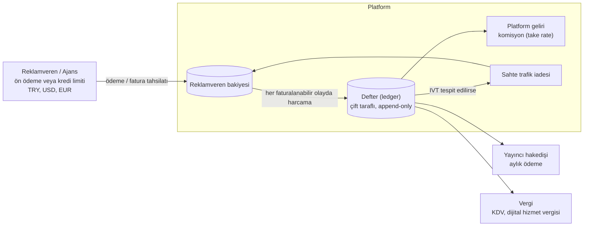

# 10. Faturalama ve Para Akışı

Pazar yeri modelinde ([9](09-exchange-ve-dsp.md)) platform reklamverenden tahsilat yapar, yayıncıya hakediş öder ve aradaki komisyonu gelir olarak kaydeder. Bu bölüm o para akışını, hesap modelini ve mutabakat süreçlerini tanımlar.

> Vergi ve muhasebe kuralları bu bölümde mimari gereksinim olarak yer alır; uygulamadan önce mali müşavir ve hukuk danışmanıyla doğrulanmalıdır.

## 10.1 Para Akışı



1. Reklamveren ön ödeme yapar ya da kredi limiti tanımlanır.
2. Her faturalanabilir olayda ([5.5 notu](05-veri-modeli.md#55-clickhouse-raporlama-tabloları)) harcama oluşur; Flink sayaçları saatlik olarak deftere işlenir.
3. Harcama yayıncı payı, platform komisyonu ve vergiye bölünür.
4. Sonradan sahte trafik olarak işaretlenen tutar reklamverene iade edilir ve yayıncı hakedişinden düşülür.
5. Ay sonunda yayıncı hakedişi ödenir, reklamverene fatura kesilir.

## 10.2 Hesap Modeli (Defter)

- **Çift taraflı kayıt:** Her işlem en az iki satırdan oluşur ve toplamı sıfırdır. Bakiye, satırların toplamından hesaplanır; ayrı bir "bakiye" alanı güncellenmez.
- **Değiştirilemez:** Hatalı kayıt silinmez, ters kayıtla (reversal) düzeltilir.
- **Idempotent:** Her kayıt bir `idempotency_key` taşır (ör. `spend:{campaign_id}:{hour}`); aynı saat iki kez işlense de çift kayıt oluşmaz.
- **Tutarlar micros** cinsinden ve hesabın para biriminde tutulur ([5.2](05-veri-modeli.md#52-postgresql-ddl-çekirdek-tablolar)).

| Hesap türü | Örnek | Yön |
|-----------|------|-----|
| `advertiser_prepaid` | Reklamveren ön ödeme bakiyesi | Ödemeyle artar, harcamayla azalır |
| `advertiser_receivable` | Kredi limitli reklamverenin borcu | Harcamayla artar, tahsilatla azalır |
| `publisher_payable` | Yayıncıya ödenecek hakediş | Harcamayla artar, ödemeyle azalır |
| `platform_revenue` | Komisyon geliri | Harcamayla artar |
| `ivt_reserve` | İade için bekletilen tutar | IVT penceresi boyunca |
| `tax_payable` | Tahakkuk eden vergi | Faturalamayla artar |

## 10.3 Harcama ve Bakiye Kontrolü

- **Gerçek zamanlı:** Flink kampanya ve reklamveren bazında harcama sayacı tutar. Ad server ve DSP bu sayacı bütçe kontrolünde kullanır ([2.3.3](02-ad-server.md#233-pacing-bütçe--teslimat-hızı), [9.4.3](09-exchange-ve-dsp.md#943-bütçe-koruması)).
- **Bakiye kapısı:** Reklamverenin kullanılabilir tutarı = ön ödeme bakiyesi (ya da kredi limiti − açık borç) − henüz deftere işlenmemiş harcama. Bu tutar son 24 saatin harcamasının altına inince reklamverene uyarı gider; sıfıra yaklaşınca (ör. 1 saatlik harcamanın altında) kampanyalar kısılır, sıfırda durur.
- **Defter işleme:** Saatlik iş, Flink'in kapanmış saat sayaçlarını deftere yazar. Gösterim başına PostgreSQL yazımı yapılmaz.

## 10.4 Komisyon ve Gelir Paylaşımı

| Satış türü | Reklamverenin ödediği | Yayıncıya kalan | Platform geliri |
|-----------|----------------------|-----------------|-----------------|
| Exchange / RTB (harici DSP) | Kazanan fiyat | Kazanan fiyat × (1 − take rate) | Kazanan fiyat × take rate |
| Exchange / RTB (bizim DSP) | Reklamverenin DSP fiyatı (DSP ücreti dahil) | Kazanan fiyat × (1 − take rate) | Exchange take rate + DSP ücreti |
| Doğrudan satış (yayıncının kendi kampanyası) | Yayıncıya ödenir, platformdan geçmez | — | Ad server lisans / kullanım ücreti (CPM başına) |
| Ağ üzerinden doğrudan / PG deal | Deal fiyatı | Sözleşmedeki pay | Sözleşmedeki pay |

- Take rate oranı yayıncı ve satış türü bazında sözleşmede tanımlanır. Her açık artırma kaydında o anki oran saklanır (`rtb.auctions`); oran sonradan değişse de geçmiş hesap değişmez.
- Fiyatlama modelleri: CPM, vCPM, CPCV, CPC, CPA ve sabit fiyatlı (sponsorship / flat) anlaşmalar. Sabit fiyatlı anlaşmalarda harcama teslimat oranına göre günlük tahakkuk edilir.

## 10.5 Sahte Trafik İadesi

- Gösterim sonrası IVT tespiti ([2.6](02-ad-server.md#26-ivt-geçersiz-trafik-ve-marka-güvenliği)) olayın üzerinden **en fazla 30 gün** içinde yapılabilir. Bu süre boyunca yayıncı payının ilgili kısmı `ivt_reserve` hesabında bekletilebilir (sözleşmeye bağlı).
- İade, orijinal harcamanın ters kaydıdır: reklamveren bakiyesi artar, yayıncı hakedişi ve platform geliri aynı oranda azalır.
- Hakediş ödendikten sonra tespit edilen IVT, bir sonraki ayın hakedişinden mahsup edilir.
- Raporlar iade sonrası rakamları gösterir; reklamveren ve yayıncı panelinde "IVT düzeltmesi" ayrı satır olarak görünür.

## 10.6 Çok Para Birimi

- Desteklenen para birimleri: **TRY, USD, EUR** (globalde genişletilebilir).
- **Kur kaynağı:** Günlük TCMB döviz satış kuru; `fx_rates` tablosunda tarih bazında saklanır. Kur değiştirilemez; düzeltme yeni kayıtla yapılır.
- **Açık artırmada:** Teklifler (`bidcur`) karşılaştırma için anlık kurla TRY'ye çevrilir; kayıtta hem orijinal tutar hem kullanılan kur saklanır.
- **Defterde:** Her hesap tek para birimindedir (reklamveren kendi seçtiği, yayıncı sözleşmedeki para biriminde). Çevrim, harcamanın deftere işlendiği günün kuruyla yapılır ve kur farkı ayrı bir hesapta izlenir.

## 10.7 Faturalama ve Vergi

- **Reklamveren faturası:** Aylık (ön ödemeli hesaplarda ödeme anında da). Türkiye'deki müşteriler için GİB'e bağlı özel entegratör üzerinden **e-fatura / e-arşiv fatura**.
- **Yayıncı hakedişi:** Ay kapanışından sonra hakediş raporu yayınlanır, yayıncı platforma fatura keser, ödeme sözleşmedeki vadede (ör. ay sonu + 45 gün) yapılır. Minimum ödeme eşiği altındaki tutarlar devreder.
- **Vergi:** KDV; yurtdışı müşteri ve yayıncılar için ülke bazlı vergi kuralları; dijital hizmet vergisi (7194 sayılı Kanun) kapsamı ve stopaj yükümlülükleri vergi danışmanıyla belirlenir. Kurallar kodda değil, ülke bazlı konfigürasyonda tutulur.
- Faturalama verisi yasal saklama süresince tutulur ([7.4](07-gizlilik-ve-uyum.md#74-saklama-süreleri-öneri)).

## 10.8 Mutabakat

| Mutabakat | Taraflar | Sıklık | Yöntem |
|-----------|---------|--------|--------|
| Olay sayısı | Collector ↔ Kafka ↔ Iceberg | Saatlik | Sayım karşılaştırma ([3.7](03-dmp.md#37-veri-kalitesi)) |
| Harcama | Flink sayaçları ↔ defter ↔ ClickHouse | Günlük | Kampanya bazında fark < %0.1, aşarsa alarm |
| Üç taraflı gösterim | Platform ↔ reklamverenin 3. parti ad server'ı ↔ yayıncı | Aylık | Sözleşmedeki tolerans (sektörde tipik %10); aşan farklar inceleme kaydı açar |
| Harici DSP | Exchange `burl` kayıtları ↔ DSP'nin raporu | Aylık | Fatura öncesi eşleştirme |
| Banka | Tahsilat / ödeme ↔ defter | Günlük | Banka ekstresi eşleştirme |

## 10.9 Veri Modeli (PostgreSQL)

```sql
CREATE TABLE billing_accounts (
    id              BIGSERIAL PRIMARY KEY,
    owner_type      TEXT        NOT NULL CHECK (owner_type IN ('advertiser','agency','publisher','platform')),
    owner_id        BIGINT      NOT NULL,
    kind            TEXT        NOT NULL CHECK (kind IN
                    ('advertiser_prepaid','advertiser_receivable','publisher_payable',
                     'platform_revenue','ivt_reserve','tax_payable','fx_difference')),
    currency        CHAR(3)     NOT NULL CHECK (currency IN ('TRY','USD','EUR')),
    credit_limit_micros BIGINT,                 -- yalnızca advertiser_receivable
    UNIQUE (owner_type, owner_id, kind, currency)
);

-- Çift taraflı defter: aynı transaction_id altındaki satırların toplamı sıfırdır
CREATE TABLE ledger_entries (
    id              BIGSERIAL PRIMARY KEY,
    transaction_id  UUID        NOT NULL,
    account_id      BIGINT      NOT NULL REFERENCES billing_accounts(id),
    amount_micros   BIGINT      NOT NULL,       -- + borç / − alacak
    kind            TEXT        NOT NULL CHECK (kind IN
                    ('payment','spend','revenue_share','ivt_refund','payout','tax','fx','reversal')),
    reference       TEXT,                       -- campaign_id:hour, invoice_id, payout_id ...
    idempotency_key TEXT        NOT NULL,
    fx_rate_id      BIGINT,
    created_at      TIMESTAMPTZ NOT NULL DEFAULT now(),
    UNIQUE (idempotency_key, account_id)
);
CREATE INDEX ON ledger_entries (account_id, created_at);

CREATE TABLE fx_rates (
    id              BIGSERIAL PRIMARY KEY,
    rate_date       DATE        NOT NULL,
    base            CHAR(3)     NOT NULL,
    quote           CHAR(3)     NOT NULL,
    rate            NUMERIC(18,8) NOT NULL,
    source          TEXT        NOT NULL DEFAULT 'TCMB',
    UNIQUE (rate_date, base, quote, source)
);

CREATE TABLE invoices (
    id              BIGSERIAL PRIMARY KEY,
    account_id      BIGINT      NOT NULL REFERENCES billing_accounts(id),
    period_start    DATE        NOT NULL,
    period_end      DATE        NOT NULL,
    net_micros      BIGINT      NOT NULL,
    tax_micros      BIGINT      NOT NULL,
    currency        CHAR(3)     NOT NULL,
    e_invoice_uuid  UUID,                       -- GİB e-fatura / e-arşiv ETTN
    status          TEXT        NOT NULL DEFAULT 'draft'
                    CHECK (status IN ('draft','issued','paid','cancelled'))
);

CREATE TABLE payouts (
    id              BIGSERIAL PRIMARY KEY,
    account_id      BIGINT      NOT NULL REFERENCES billing_accounts(id),   -- publisher_payable
    period          DATE        NOT NULL,       -- ayın ilk günü
    gross_micros    BIGINT      NOT NULL,
    ivt_adjust_micros BIGINT    NOT NULL DEFAULT 0,
    net_micros      BIGINT      NOT NULL,
    currency        CHAR(3)     NOT NULL,
    status          TEXT        NOT NULL DEFAULT 'pending'
                    CHECK (status IN ('pending','approved','paid','carried_over')),
    UNIQUE (account_id, period)
);
```

`ledger_entries` için de [5.2](05-veri-modeli.md#52-postgresql-ddl-çekirdek-tablolar)'deki `audit_log` gibi UPDATE / DELETE engellenir; düzeltme yalnızca `reversal` kaydıyla yapılır.

## 10.10 Kontroller

- **Görevler ayrılığı:** Kredi limiti tanımlama, manuel düzeltme kaydı ve hakediş onayı farklı rollerdedir; her biri çift onay ister ve `audit_log`'a yazılır.
- **Kapanış:** Ay kapanışından sonra o döneme kayıt yazılamaz; düzeltmeler bir sonraki döneme ters kayıtla girer.
- **SLO:** Saat kapanışından deftere işlenme < 15 dk; günlük harcama mutabakatı farkı < %0.1.
