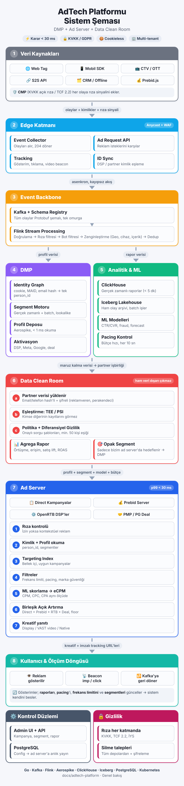
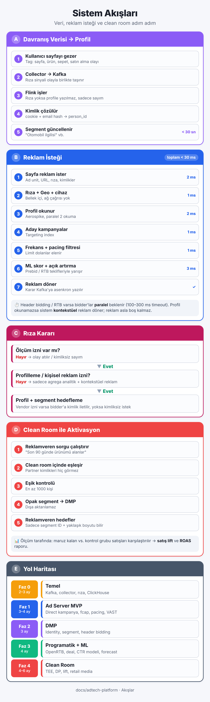
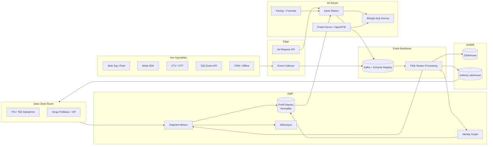

# AdTech Platformu — DMP + Ad Server + Data Clean Room Mimarisi

Bu doküman seti; birinci parti veri toplayan bir **DMP / CDP**, bu veriyi gerçek zamanlı kullanan bir **Ad Server (karar motoru + RTB)** ve partnerlerle ham veri paylaşmadan ortak analiz yapılmasını sağlayan bir **Data Clean Room (DCR)** içeren platformun uçtan uca mimarisini tanımlar.

> Tasarım ilkeleri: **cookieless-first**, **privacy-by-design (KVKK/GDPR)**, **gerçek zamanlı** (karar p99 < 30 ms), **çok kiracılı (multi-tenant)**, **olay güdümlü (event-driven)** ve **yatay ölçeklenebilir**.

## Görsel Özet (mobil uyumlu)

| Sistem Şeması | Sistem Akışları |
|---|---|
|  |  |

## Doküman Haritası

| # | Doküman | İçerik |
|---|---------|--------|
| 1 | [Genel Mimari](01-genel-mimari.md) | Katmanlar, bileşenler, ana veri akışları |
| 2 | [Ad Server](02-ad-server.md) | Ad request akışı, karar motoru, açık artırma, pacing, frequency cap, RTB, VAST, tracking, IVT |
| 3 | [DMP](03-dmp.md) | Veri toplama, identity graph, profil deposu, segmentasyon, aktivasyon |
| 4 | [Data Clean Room](04-data-clean-room.md) | Eşleştirme (PSI/TEE), sorgu politikaları, diferansiyel gizlilik, kullanım senaryoları |
| 5 | [Veri Modeli](05-veri-modeli.md) | PostgreSQL / ClickHouse DDL, Protobuf olay şemaları, profil kaydı, ER diyagramı |
| 6 | [Altyapı ve Teknoloji](06-altyapi-ve-teknoloji.md) | Teknoloji yığını, dağıtım topolojisi, gecikme bütçesi, kapasite, SLO, gözlemlenebilirlik |
| 7 | [Gizlilik ve Uyum](07-gizlilik-ve-uyum.md) | KVKK, GDPR, TCF 2.2 / GPP, rıza akışı, silme talepleri, saklama süreleri |
| 8 | [Yol Haritası](08-yol-haritasi.md) | Fazlar, MVP kapsamı, ekip yapısı |

## Tek Bakışta Sistem

## Kritik Tasarım Kararları (Özet)

1. **Tek event backbone:** DMP olayları ve reklam olayları aynı Kafka + Protobuf şema altyapısını kullanır; böylece raporlama, atıflama (attribution) ve segmentasyon aynı veriden beslenir.
2. **Sıcak yol / soğuk yol ayrımı:** Ad Server sıcak yolunda (hot path) yalnızca bellek içi indeksler ve tek-hop KV okumaları vardır; hiçbir senkron veritabanı sorgusu, hiçbir senkron Kafka yazımı yoktur.
3. **Kimlik katmanı ayrı servis:** Cookie, MAID, hashed email, PPID, UID2 / ID5 gibi kimlikler tek bir `person_id` altında birleşir; 3. parti cookie'ye bağımlılık yoktur.
4. **Rıza her katmanda uygulanır:** Toplama, profilleme, aktivasyon ve clean room aşamalarının her birinde rıza (consent) kontrolü yapılır; rıza sinyali olayla birlikte taşınır.
5. **Clean room'dan satır seviyesinde veri çıkmaz:** Yalnızca eşik ve gürültü uygulanmış agregalar ya da ad server içinde kullanılabilen, dışa aktarılamayan segmentler çıkar.
